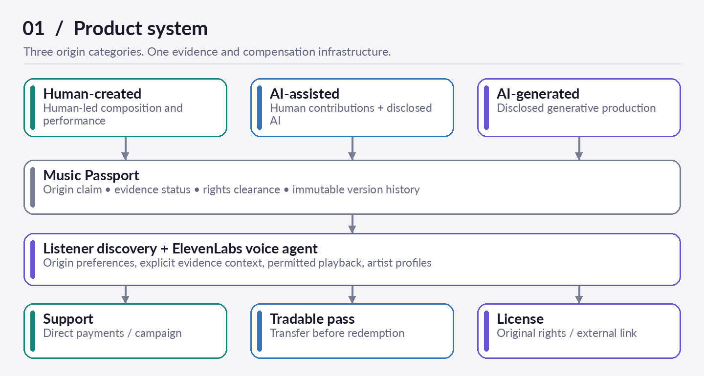
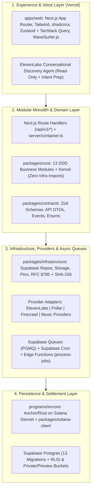

# ENCORE

> **Know what you listen to. Choose who you support. Give every legitimate creator a fair path to earn.**

**Encore** is a music discovery, provenance, and fan-support platform built for the **Dev3pack Global Hackathon** on **Solana devnet** (Version 1.0 | 26 November 2026 | Working title).

> **Vision:** Suno's creative accessibility + Spotify's discovery experience + Superfan's fan-powered economics, connected by a portable, transparent music-provenance and rights layer. *(This is a product direction, not a claim that the three services are integrated or reproduced in 48 hours.)*



---

## 60-Second Overview

- **What it solves:** Listeners struggle to tell how music was made (human, AI-assisted, or AI-generated) and independent creators struggle to earn sustainable income, while binary AI labels or opaque detectors fail both groups.
- **P0 Differentiator:** One track-specific **Music Passport** (canonical manifest hash + versioned history on Solana) that powers discovery, ElevenLabs voice explanations, direct test-USDC tips, redeemable Supporter Passes, and a non-destructive appeal workflow.
- **Fairness Principle:** Human-created, AI-assisted, and AI-generated tracks are all welcome with valid permissions. **Missing evidence is not an AI label.** Origin labels never algorithmically penalize creator payouts.
- **Current Status:** Phase 2 registry, Music Passport, private uploads and public catalog verified on devnet. Three demo tracks and owner-managed web staging remain. See the [Phase 2 handoff](docs/planning/PHASE_TWO_REPORT.md).

---

## Documentation Wiki

Browse the full knowledge base in [`docs/WIKI.md`](docs/WIKI.md) or jump directly to any section:

| Category | Document | Purpose |
| :--- | :--- | :--- |
| **Master Spec** | [`docs/PRD.md`](docs/PRD.md) | Complete v1.0 Product Requirements Document |
| **Wiki Hub** | [`docs/WIKI.md`](docs/WIKI.md) | Role-based navigation, glossary & quick links |
| **Product Design** | [`docs/product/PRODUCT_DESIGN.md`](docs/product/PRODUCT_DESIGN.md) | Pillars, personas, `FR01`–`FR11`, UX/UI & 3-min pitch |
| **Origin & Fairness** | [`docs/product/TAXONOMY_AND_FAIRNESS.md`](docs/product/TAXONOMY_AND_FAIRNESS.md) | Origin vs. evidence vs. rights taxonomy, appeals |
| **Architecture** | [`docs/architecture/ARCHITECTURE.md`](docs/architecture/ARCHITECTURE.md) | Monorepo layout, Supabase schema, APIs & indexing |
| **Solana Program** | [`docs/architecture/ANCHOR_PROGRAM_SPEC.md`](docs/architecture/ANCHOR_PROGRAM_SPEC.md) | Anchor accounts, PDAs, instructions & invariants |
| **Feasibility & ADRs** | [`docs/architecture/TECHNICAL_FEASIBILITY.md`](docs/architecture/TECHNICAL_FEASIBILITY.md) | Sponsor stack feasibility, fallbacks & ADRs |
| **Tokenomics** | [`docs/economics/TOKENOMICS_AND_ECONOMICS.md`](docs/economics/TOKENOMICS_AND_ECONOMICS.md) | Direct tips, Supporter Pass math, fee splits & caps |
| **Rights & Licensing** | [`docs/legal/RIGHTS_AND_LICENSING.md`](docs/legal/RIGHTS_AND_LICENSING.md) | Three-layer rights check, `D01`–`D10` pack & rules |
| **Privacy & Terms** | [`docs/legal/PRIVACY_AND_TERMS.md`](docs/legal/PRIVACY_AND_TERMS.md) | Private storage vs. on-chain hashes, consent & terms |
| **Security & Threats** | [`docs/security/SECURITY_AND_THREAT_MODEL.md`](docs/security/SECURITY_AND_THREAT_MODEL.md) | Threat model, mitigations, agent & SSRF guardrails |
| **Security Audit Log** | [`docs/security/AUDIT_LOG.md`](docs/security/AUDIT_LOG.md) | Living audit findings, invariant checks & sign-offs |
| **Testing & QA** | [`docs/testing/TEST_PLAN_AND_REPORT.md`](docs/testing/TEST_PLAN_AND_REPORT.md) | Contract, provenance & UX test matrix + live results |
| **48h Build Plan** | [`docs/planning/BUILD_PLAN_48H.md`](docs/planning/BUILD_PLAN_48H.md) | `H00–H48` schedule, team ownership & cut-lines |
| **Completion Log** | [`docs/planning/COMPLETION_LOG.md`](docs/planning/COMPLETION_LOG.md) | Live milestone tracker, `FR01`–`FR11` status & changelog |
| **Research & Citations** | [`docs/research/MARKET_RESEARCH_AND_CITATIONS.md`](docs/research/MARKET_RESEARCH_AND_CITATIONS.md) | Market data, competitors, hypotheses & sources `[1]`–`[26]` |

---

## Architecture at a Glance

Open the [architecture diagram gallery](docs/diagrams/architecture/README.md) for the system blueprint and marketplace proposals.

**Pattern:** TypeScript monorepo (`pnpm Workspaces + Turborepo`) containing a **modular monolithic application** (`apps/web` + `packages/core` + `packages/infrastructure`), a **single modular Solana Anchor program** (`programs/encore`), and shared contracts/clients.



```text
apps/web/              Next.js App Router ((public), (auth), (platform), (studio), (admin), /api/v1/*)
packages/core/         13 isolated DDD modules + kernel (zero DB/RPC/framework imports)
packages/infrastructure/ Supabase repos, storage, crypto, provider adapters, outbox jobs, Pino
packages/contracts/    Zod schemas, API DTOs, domain events, enums
packages/solana-client/ Generated Anchor IDL/TS client, PDA helpers, instruction builders
packages/config/       Shared env, ESLint boundary rules, TypeScript configs
programs/encore/       Single modular Anchor/Rust program (state, instructions, validation, utils)
supabase/              13 incremental SQL migrations with RLS, seed.sql, rls/constraints tests
tests/                 Vitest unit, Anchor/LiteSVM contract, Playwright E2E, tests/security/
scripts/               bootstrap, seed-demo, reset-demo, create-test-mint, reconcile-payments
docs/                  Categorized project wiki, specs, audit/completion logs, and diagrams
```

### Sponsor Integrations (Behind Provider Adapters)
- **Solana (Devnet):** Versioned `PassportVersion` PDAs, `SupportReceipt` binding, atomic `PassSeries`/`SupporterPass` sales.
- **ElevenLabs:** Read-only conversational discovery & unsigned support-intent preparation (never executes payments or mutates origin status).
- **Pollar:** Embedded/social wallet spike with Solana Wallet Standard fallback.
- **Firecrawl:** Narrow authorized crawl of public commissioning briefs via `OpportunityProvider`.
- **Supabase:** Auth, Postgres with 13 RLS migrations, private/preview storage buckets, and outbox jobs.

---

## Quick Start & Root Commands (Target Contract)

> Run `pnpm setup:local` to create `apps/web/.env.local` without overwriting an existing file. See [credential setup](docs/setup/CREDENTIALS.md). Contract/deployment/demo commands remain later-phase targets; their presence does not mean those features are implemented.

1. **Prerequisites:** Node.js (LTS), `pnpm`, Rust + Solana CLI + Anchor CLI (pinned during `H00–02` spike), Supabase CLI.
2. **Environment:** Run `pnpm setup:local` to create `apps/web/.env.local` (never commit secrets, seed phrases, or Supabase service-role keys).
3. **Core Commands:**
   - `pnpm dev` / `pnpm build` — Run or build the Turborepo workspace
   - `pnpm lint` / `pnpm typecheck` — Lint, module-boundary checks, and TypeScript validation
   - `pnpm test` / `pnpm test:contracts` / `pnpm test:e2e` — Vitest unit, Anchor/LiteSVM contract, and Playwright E2E tests
   - `pnpm db:reset` / `pnpm demo:seed` / `pnpm demo:reset` — Reset DB and manage authorized fixtures (`H01`, `A01`, `G01`)
   - `pnpm chain:build` / `pnpm chain:deploy:devnet` / `pnpm chain:generate` / `pnpm reconcile` — Build/deploy Anchor program, sync IDL client, and reconcile payments

---

## License & Disclaimer

This repository contains product specifications, architectural documentation, and hackathon planning materials. **Nothing in `docs/` constitutes legal advice, a commercial license agreement, or a securities offering.** Live mainnet deployment requires independent legal counsel and smart-contract security audits.
