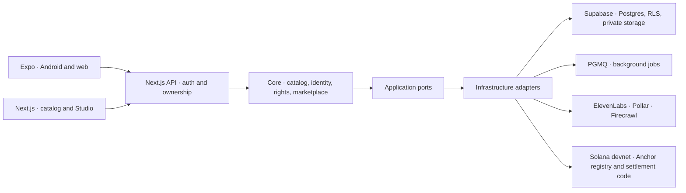
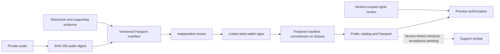

# Encore

**Find music you love. Support the artist directly.**

Encore is a music discovery, provenance, and fan-support platform built for the Dev3pack Global Hackathon on Solana devnet.

[How artists earn](#how-artists-earn) · [Track alignment](#hackathon-track-alignment) · [Evidence](#verification-evidence) · [Wiki](docs/WIKI.md) · [Roadmap](plan.md)


## 🎧 Meet Encore

**Discover a track → meet the artist → tip or buy a Supporter Pass.**

- **For fans:** Go from a track you love to supporting its eligible artist in the same app. See who receives the money, review the amount, and approve with your wallet.
- **For independent artists:** Give even a small audience a direct way to contribute. A fan can tip from an eligible release or buy a pass for a creator-defined perk.
- **For both:** A **Music Passport** shows how the track was made, what evidence supports the disclosure, and what rights were reviewed. The checkout design ties support to the exact Passport version the fan saw.

## How artists earn

| Fan action | Artist benefit |
| --- | --- |
| 💸 **Send a direct tip** | **100% of the tip** goes to the artist’s payout wallet in the MVP fee model. Encore charges **0% platform fee** on tips. Network fees are separate. |
| 🎟️ **Buy a Supporter Pass** | The artist sets the terms for a finite run of creator perks. On a primary sale the artist receives the price minus a 5% platform fee, rounded down in smallest units. |
| 🔁 **Buy a listed pass from another fan** | On an eligible resale, the artist receives a 10% share and the platform receives 5%, both rounded down. The seller receives the remainder. |

- **Checkout:** Choose the release and amount or pass → review recipient and fees → sign → look up the receipt.
- **Example:** A 5 test-USDC tip sends all 5 to the artist. A 10 test-USDC primary pass sale sends 9.50 to the artist and 0.50 to Encore. [Economy rules and fee examples](docs/economics/TOKENOMICS_AND_ECONOMICS.md)
- **Build status:** The devnet prototype includes settlement instructions, checkout APIs, and fee tests. The complete multi-wallet payout and redemption demo is pending. [Economy integration tests](tests/contracts/encore-economics.test.ts)

## The problem

- **Listeners want disclosure.** In Deezer and Ipsos’s 2026 survey, 80% of respondents agreed that both fully AI-generated and AI-assisted music should be clearly labeled. This measures attitudes in that survey. [Deezer and Ipsos AI music barometer](https://newsroom-deezer.com/2026/11/ai-music-labeling-deezer-ipsos-survey/)
- **Credits, evidence, and permissions answer different questions.** C2PA’s music guidance treats AI disclosure, production history, and creator credits as provenance use cases. Licensing and ownership still need their own evidence and decisions. [C2PA music asset guidance](https://spec.c2pa.org/specifications/specifications/2.4/music/guidance_applying_content_credential_music_assets.html)
- **A stream and a direct contribution serve different purposes.** Spotify explains that it pays rightsholders based on streamshare and that an artist’s contracts govern what reaches them. Encore’s hypothesis is that a direct, version-linked contribution gives fans a complementary way to support a creator they discover. Demand for Encore’s specific flow still needs validation. [Spotify for Artists royalties guide](https://artists.spotify.com/en/royalties-guide)

See the [research library](docs/research/MARKET_RESEARCH_AND_CITATIONS.md) for market context, comparisons, and hypotheses.

## How Encore works

1. **Create or upload.** Artists upload an MP3 to private storage or try voice-directed arrangement and ElevenLabs Music generation in the local Studio.
2. **Disclose and review.** The release has a declared origin, an evidence status, and a rights status. Missing evidence stays unverified. A scoped instrumental proof corroborates a contribution within its scope. Rights approval is handled separately.
3. **Anchor and discover.** The artist signs with a linked wallet. Encore checks finalized Solana account state before publishing the reviewed version. Listeners search the catalog and play permitted previews using short-lived URLs.
4. **Support.** Checkout is designed to reference the exact reviewed Passport version. Tips and Supporter Passes have implementation and tests, with the complete multi-wallet devnet acceptance run still open.

| Passport field | Question it answers |
| --- | --- |
| **Origin** | Was the track human-created, AI-assisted, AI-generated, or of unknown origin? |
| **Evidence** | What supports the disclosure, and how much of the track does it cover? |
| **Rights** | What use has been reviewed and permitted for this version? |

## Technical architecture

Encore is a TypeScript modular monolith with shared contracts, a Next.js API, an Expo client, Supabase persistence, and one Rust/Anchor program. Its core depends on ports. Provider SDKs, database access, and server credentials stay behind server-side boundaries.



| Layer | Implementation |
| --- | --- |
| Client and API | [Expo Router](apps/mobile) and [Next.js routes](apps/web/src/app/api/v1) for discovery, playback, identity, Studio, rights, and marketplace |
| Domain and contracts | [Core](packages/core) for application rules and [Zod contracts](packages/contracts) shared across clients and server |
| Adapters and state | [Infrastructure](packages/infrastructure) and [Supabase](supabase) for persistence, private media, queues, wallet/provider integrations, and provenance verification |
| Chain | [Rust/Anchor program](programs/encore) and [TypeScript Solana client](packages/solana-client) for Passport registry, instruction builders, and settlement |

### From audio to an anchored Passport



Public views expose approved facts and commitments. Private audio and rights files stay in protected storage. A later revision links to its predecessor. The registry records a commitment to the manifest, and the manifest binds to the audio digest.

### ElevenLabs Music Studio

- 🎛️ **Create and arrange:** Dictate or type a brief, set mood, BPM, and key targets, then review the assistant’s proposed sections before rendering. Choose a beat, instrumental, or song with lyrics. [Studio test page](apps/web/src/app/%28studio%29/studio/music-test)
- 🎙️ **Review the take:** Compare submitted lyrics with returned word timestamps when available. Click a possible variation to listen, then export an approval receipt tied to the audio’s SHA-256.
- 🔎 **Check an upload:** Compare file hashes, decoded audio, and acoustic fingerprints against indexed local takes. Opt into a provider watermark check when appropriate. A candidate match goes to review. No match leaves origin unverified. [ElevenLabs provenance API](https://elevenlabs.io/docs/eleven-api/concepts/content-provenance)
- **Pending:** Hosted verification and a complete generation-to-catalog-to-Passport run. [Music generation plan](docs/planning/ENCORE_MUSIC_GENERATION_PLAN.md)

## Progress and implementation

| Milestone | Current evidence |
| --- | --- |
| **Foundation and identity** | External Pollar wallet authentication, isolated Supabase persistence, test-mint transfers, and Firecrawl feasibility recorded. Expo session exchange and PGMQ worker verified locally. Hosted social and embedded-wallet paths remain open. |
| **Registry and catalog** | Private upload, review, immutable Passport revision, finalized publication, search, and playback verified in the Phase 2 run with synthetic audio. |
| **Artist Studio and provenance** | Owner APIs, draft revisions, delisting, and a scoped signed-instrumental proof path. Simulated results are labeled separately. Production issuer integration remains open. |
| **Rights, discovery, and playback** | Version-scoped rights review, inquiries, withdrawal, and real preview playback verified locally on Next.js and Expo Web. Native-device playback and hosted rollout remain open. |
| **Music generation and arrangement** | A live short beat render and composition-plan requests passed during development. Lyrics Review and re-encode fingerprint matching were checked locally. Live watermark and lyric-timestamp delivery still need a run. |
| **Artist monetization and supporter marketplace** | Campaign, pass, spot, distribution, and receipt code is present, with instruction builders and contract test scenarios. Complete devnet settlement, replay rejection across wallets, and dashboard reconciliation remain open. |

The [current 0–14 roadmap](plan.md) tracks acceptance work. The [completion log](docs/planning/COMPLETION_LOG.md) and [original phase snapshot](docs/planning/PROGRESS_SNAPSHOT.md) preserve the earlier build milestones and phase numbering.

## Hackathon track alignment

This is an **evidence-based fit assessment** against the public track descriptions and sponsor announcements. The [official member prize dashboard](https://app.dev3pack.xyz/hackathon/member/dashboard/prizes) requires sign-in, so detailed judging criteria, submitting to multiple tracks, and eligibility still need confirmation. [Public prize page](https://hack.dev3pack.xyz/#prizes) · [Dev3pack sponsor announcement](https://x.com/dev3pack/status/2125209075248210031)

| Publicly announced track or prize | Encore fit | Evidence and remaining work |
| --- | --- | --- |
| **Solana · Best App Overall** | **Strong technical fit** | Solana is used for finalized Passport commitments and is central to the settlement design. [Devnet deployments](docs/architecture/DEVNET_DEPLOYMENTS.md) · [Verified registry run](docs/planning/PHASE_TWO_REPORT.md). The full support lifecycle still needs devnet evidence. |
| **ElevenLabs** | **Strong prototype fit** | Live Music generation and arrangement planning, with timestamp-based lyric review and opt-in watermark checking in Studio. [Verification notes](docs/testing/MUSIC_STUDIO_VERIFICATION.md). Verify live lyric timestamps, watermarks, and generated-release publication. |
| **Supabase** | **Strong implementation fit** | Postgres, RLS, private media, and PGMQ support the release lifecycle. [Identity and database handoff](docs/setup/EXPO_AUTH_AND_DATABASE.md) · [Rights and playback verification](docs/architecture/RIGHTS_AND_PLAYER_IMPLEMENTATION.md#local-verification). Hosted rollout remains open. |
| **Solana Mobile · Best Mobile App** | **Partial** | Expo Android client with Mobile Wallet Adapter and Seeker checks. [Mobile setup](apps/mobile/README.md). Evidence covers Expo Web playback. Verify the native journey on supported hardware and confirm mobile-track requirements. |
| **Pollar** | **Partial** | The external-wallet authentication path was verified. Pollar publicly highlights wallets and payments for its bounty. [Pollar integration](docs/integrations/POLLAR.md) · [Sponsor announcement](https://x.com/pollar_xyz/status/2125226065530368170). A Pollar-powered payment flow is unverified. |
| **Firecrawl** | **Feasibility only** | One authorized scrape passed. Creator opportunity extraction and matching are still planned. [Phase 1 live results](docs/testing/PHASE_ONE_LIVE_RESULTS.json). |
| **ByteArena** | **No documented alignment** | No ByteArena integration or evidence is documented in Encore. Exact sponsor criteria require the dashboard. |
| **Local build-station prizes** | **Eligibility unverified** | Publicly limited to selected locations. Confirm the team’s build-station registration and local rules in Dev3pack. [Public prize page](https://hack.dev3pack.xyz/#prizes) |

The organizer also lists student perks and an accelerator opportunity. Confirm access separately from the app’s technical fit. [Dev3pack public prize page](https://hack.dev3pack.xyz/#prizes)

## Verification evidence

| Evidence | What to inspect |
| --- | --- |
| Provider and environment checks | [Phase 1 live results](docs/testing/PHASE_ONE_LIVE_RESULTS.json) and [handoff](docs/planning/PHASE_ONE_REPORT.md) |
| Registry and catalog run | [Phase 2 live results](docs/testing/PHASE_TWO_LIVE_RESULTS.json) and [handoff](docs/planning/PHASE_TWO_REPORT.md) |
| Public chain records | [Recorded devnet program, finalized transactions, and binary hashes](docs/architecture/DEVNET_DEPLOYMENTS.md) |
| Studio scoped provenance | [Issuer trust, proof binding, and verification commands](docs/setup/STUDIO_AND_PROVENANCE.md) |
| Music Studio prototype | [Development checks, reproduction steps, and open acceptance criteria](docs/testing/MUSIC_STUDIO_VERIFICATION.md) |
| Rights and playback | [Local cross-client playback and rights-withdrawal verification](docs/architecture/RIGHTS_AND_PLAYER_IMPLEMENTATION.md#local-verification) |
| Settlement code | [Economy integration tests](tests/contracts/encore-economics.test.ts), [instruction builder tests](packages/solana-client/src/marketplace.test.ts), and [economic rules](docs/economics/TOKENOMICS_AND_ECONOMICS.md) |
| Safety and acceptance | [Threat model](docs/security/SECURITY_AND_THREAT_MODEL.md), [audit log](docs/security/AUDIT_LOG.md), and [test plan](docs/testing/TEST_PLAN_AND_REPORT.md) |

The local Vitest run on 28 November 2026 at `2e671a2` passed **94 tests across 26 files**. The linked live reports record the separate devnet and browser runs.

## Run locally

From the repository root, with the pinned Node and pnpm versions available:

```sh
pnpm install --frozen-lockfile
pnpm setup:local
pnpm dev
```

See [credential setup](docs/setup/CREDENTIALS.md) and [Expo authentication and database setup](docs/setup/EXPO_AUTH_AND_DATABASE.md). For a loopback-only Music Studio test, configure a server-side `ELEVENLABS_MUSIC_API_KEY`, leave `ENCORE_MUSIC_TEST_ARTIST_ID` blank, and set `NEXT_PUBLIC_APP_URL=http://127.0.0.1:3000` in `apps/web/.env.local`. Run `pnpm --filter @encore/web dev --hostname 127.0.0.1` and open [Music Studio](http://127.0.0.1:3000/studio/music-test). Generation uses credits. Local acoustic matching needs FFmpeg with Chromaprint support.

Use `pnpm lint`, `pnpm typecheck`, and `pnpm test` for local checks. Live and browser scenarios require the fixtures and configuration in their linked reports.

## Future scope

1. **Complete the demo release.** Take an ElevenLabs render through private save, lyric review, evidence attachment, rights review, and finalized Passport publication. Verify one devnet support receipt references that version.
2. **Close devnet economic acceptance.** Verify primary purchase, listing, resale, redemption, replay rejection, and reconciled balances across wallets. Keep campaign and distribution demonstrations scoped to test assets.
3. **Roll out and validate.** Seed authorized demo releases, apply hosted migrations and worker configuration, test Expo on physical devices, and collect feedback on discovery labels, appeals, and willingness to support a creator.
4. **Expand scoped integrations.** Verify live catalog-aware ElevenLabs voice tools, provider-issued evidence, and permitted Firecrawl opportunity matching. Any payment still requires explicit wallet authorization.

## Brand and wiki

**Encore** is a creator-friendly name for returning to support a track or artist. The product voice is clear, curious, and evidence-led. The visual identity uses dark charcoal, violet, and teal, with amber for review states. Use explicit labels alongside color for origin, evidence, and rights. See the [product design and visual identity](docs/product/PRODUCT_DESIGN.md).

The [documentation wiki](docs/WIKI.md) is the index for product, architecture, economics, rights, research, integration setup, and QA. It also links the [diagram gallery](docs/diagrams/architecture/README.md). See [contributing](CONTRIBUTING.md) and [security](SECURITY.md) for project policies.
