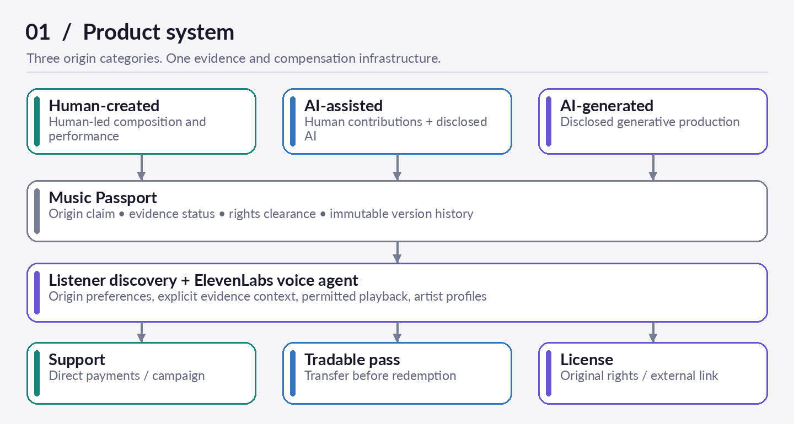
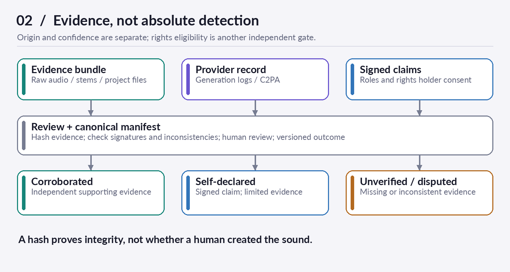
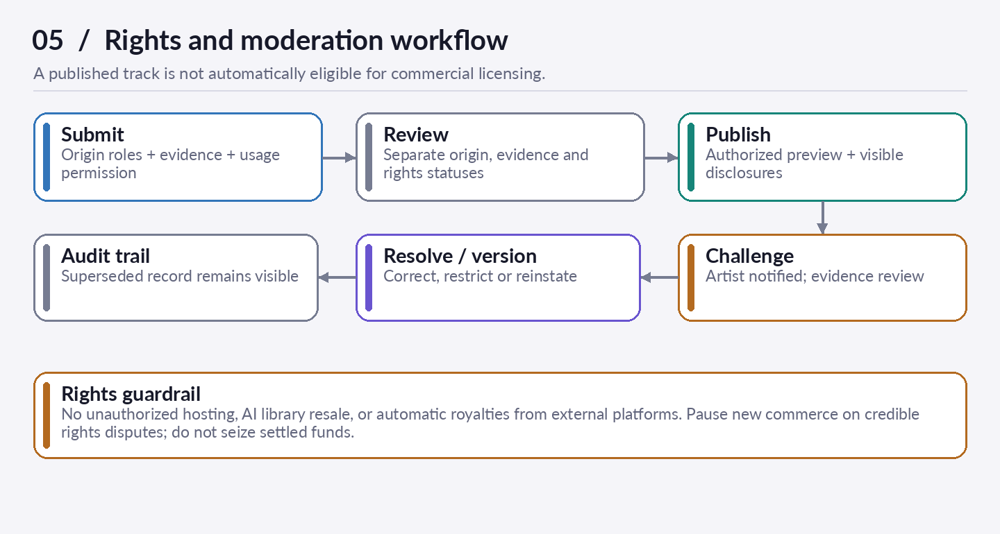
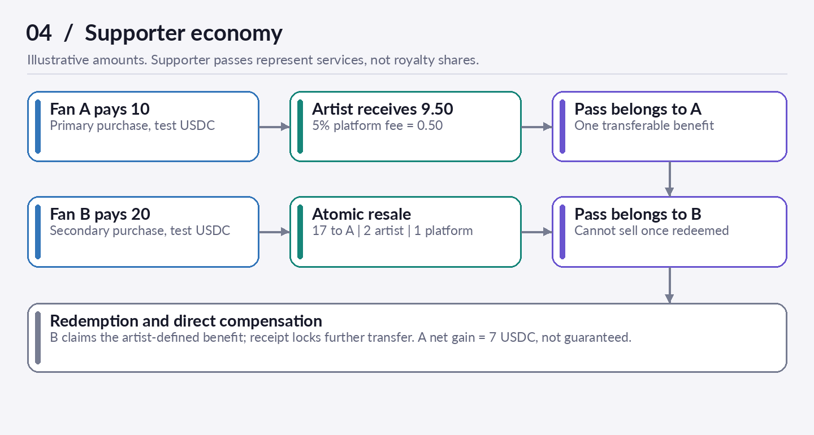
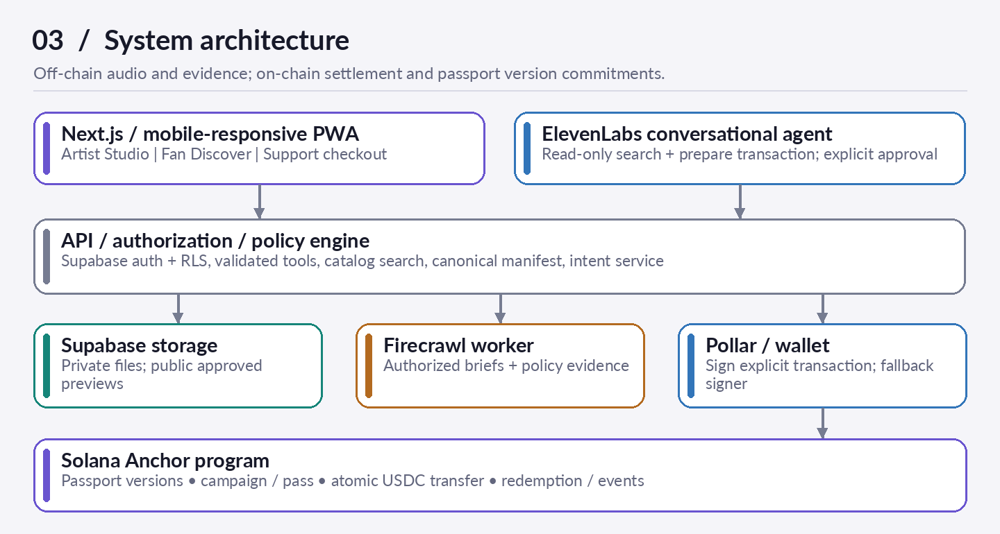
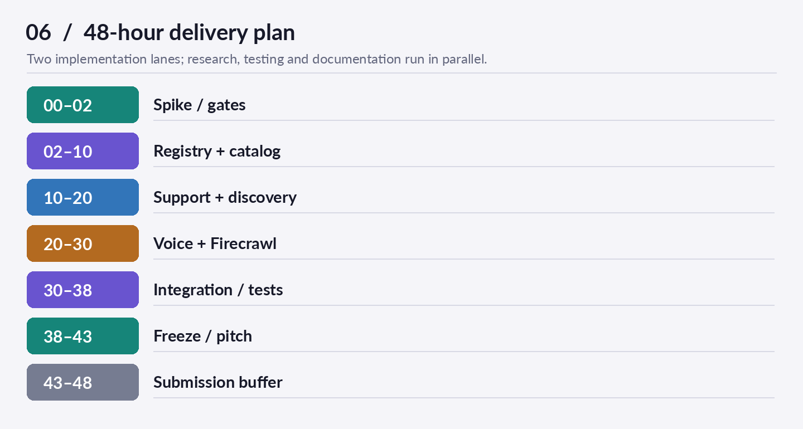

# ENCORE

## Product requirements document, market research and 48-hour MVP playbook

Version 1.0 \| 26 November 2026 \| Dev3pack Global Hackathon \| Solana devnet \| Working title

VISION: Suno's creative accessibility \+ Spotify's discovery experience \+ Superfan's fan-powered economics, connected by a portable, transparent music-provenance and rights layer. This is a product direction, not a claim that the three services are integrated or that we can reproduce them in two days.

# 01 — Executive decision

Encore helps listeners discover music with accurate context about its creative origin, helps creators understand and contest how they are represented, and lets fans support them directly through auditable payments and redeemable supporter rights. Human-created, AI-assisted and AI-generated music are welcome if the creator has the relevant permissions. Missing evidence is not an AI label.

   
Primary customer: emerging independent musicians and AI-assisted creators who want to be discovered and paid by listeners who understand their work. Secondary customers: fully generated music creators with legitimate permissions, fans, collaborators and commercial buyers. Start with a curated, consented catalog, not mass upload.

P0 differentiator: one track-specific evidence and rights manifest, versioned on Solana, powers discovery, voice explanations, artist-controlled support and an appeal workflow. The payment receipt references the exact passport version shown to the fan. The user chooses who to pay; the origin label does not algorithmically determine the creator's entitlement to royalties.

Hackathon thesis: truthful attribution can become economically meaningful if the listener sees the actual creation context before supporting an artist and the creator has a way to correct errors. Show this with real devnet transactions and adversarial tests, not a claim that our detector proves authorship.

Status: proposed; no code, verified adoption, market demand, licenses, legal approval, audit or measured performance exists yet. Scores, prices and KPI targets are hypotheses. The 48-hour schedule assumes two implementation-focused builders and two teammates for research, QA, evidence, design and submission. Adapt if team composition differs.

# 02 — Market research: evidence and unmet needs

## 2.1 Transparency and discovery

Deezer's November 2026 Ipsos survey reports 80% of respondents want AI music labeled, including AI-assisted work. Reuters reports that 72% of streaming users want to know when AI tracks are recommended; the study sampled 9,000 adults in eight countries. Its 2025 blind-listening study found 97% of participants did not correctly distinguish fully generated from human-made music in that test. These results support informed discovery, not a claim that classifiers fail at the same rate. \[1–3\]

In April 2026, Deezer reported fully generated music accounted for 44% of its new uploads. This is a platform upload statistic, not total catalog share, listening share or a measurement of human artists' lost royalties. Synthetic uploads and attention competition motivate separate disclosure and discovery controls, not a blanket ban. \[4\]

Spotify provides AI credits for specific roles, AI Persona labels and artist profile protection. It explicitly notes that absent credits cannot establish that AI was not used because disclosure depends partly on creators and distributors. Deezer announced a listener filter for fully generated music. Both are credible efforts; the research gap is not that incumbents do nothing, but that integrity of disclosures, portable evidence, user choice and compensation can be connected. \[1,5–6\]

## 2.2 Independent creator income and commercial eligibility

Ditto Music's 2026 survey of 5,039 independent artists in 112 countries reports 74% earned below \$1,000 from music in the prior year, 67% say social video is their biggest source of new fans, and 47% already use AI in production. Respondents were recruited via Ditto's channels, so do not generalize directly to all artists. This motivates support tools, fan conversion and role-specific disclosures. \[7\]

Bandcamp prohibits music generated wholly or substantially by AI. Suno's commercial rights depend on plan and timing; free-tier creations generally lack commercial permissions and subscribing later does not automatically change prior outputs. ElevenLabs offers an official Music Marketplace but its separate Music Terms restrict external libraries and model resale. Therefore, a creator's eligibility is contextual and cannot be inferred from the origin label alone. \[8–11\]

US Copyright Office's 2025 copyrightability analysis distinguishes human creative contributions from purely generated material. AI assistance does not automatically prevent protection of human-authored expression. Commercial use permission from a provider is not the same as copyright ownership; this US guidance is not a global legal rule. India and other target markets require independent legal review. \[12\]

## 2.3 Research gap and falsifiable hypotheses

H1 — Listeners given role-specific origin disclosures and evidence status understand who made a track better than listeners given a single binary AI label. Test comprehension, not taste. H2 — Listeners who value different creation methods will intentionally direct support toward chosen creators when shown disclosure and a simple checkout. Test conversion and stated willingness separately. H3 — Artists prefer transparent, challengeable classification over opaque binary detection. Test artist onboarding friction and appeal comprehension. H4 — At least some creators can offer useful, transferable supporter benefits without selling speculative royalty interests. Test redemption willingness and secondary demand separately.

Do not equate the problem with “AI is stealing all artist income.” The causal effect of undisclosed AI music on human artists' earnings is not established by these surveys. Market size and willingness to pay for our exact product remain unvalidated.

Bottom-up planning scenario: 100 artists with 50 monthly paying supporters each at 5 USDC produces 25,000 USDC support volume/month; a 5% pass fee on eligible purchases would yield 1,250 USDC if all purchases are fee-bearing. Direct tips in our MVP have no platform fee. This is a scenario, not TAM, ARR or a forecast; calculate actual gross margin after payment, storage, agent and moderation costs.

# 03 — Competitive landscape and positioning

Syntha is the strongest direct competitor. It already supports human, AI-assisted, synthetic, transformed and hybrid music, visible provenance and rights posture, browsing by origin and direct artist support. Its published API exposes origin and trust-related data. It also has an appeals policy. Do not claim category separation, provenance, creator support or appeals as unique. \[13–15\]

Spotify / Deezer: massive distribution and existing origin disclosure or detection tools; compete on discovery, not their scale. Suno / ElevenLabs: create and edit AI music and provide plan-dependent commercial rights; ElevenLabs also operates a licensing marketplace. Superfan: artist funding via Solana/MetaDAO futarchy in its earlier submission; more recent opinion markets route fees into artist treasuries. TasteMaker: verified human music, community financing and ownership, advertised in Solana test mode. BeatProof: on-chain licensing and stems with usage verification in a hackathon submission. Bandcamp: direct-to-fan monetization, but restrictive AI policy. \[5,6,8–11,16–19\]

Competitive feature matrix (documented public positioning; not independently tested):

Product         Origin-aware   Fan funding     Programmable rights  
Spotify/Deezer  Yes            Not core       Not established  
Suno/ElevenLabs Varies         Not core       Platform terms apply  
Syntha          Yes            Yes            Rights-aware platform  
Superfan        Not core       Yes            Artist-market positions  
TasteMaker      Human focus    Yes            Project ownership  
Encore\*       Yes            Yes            Support receipt \+ pass  
\* Proposed. Encore's narrower differentiation is portable, version-bound evidence receipts at the time of payment; independently auditable direct payments and an unused transferable supporter right; dispute history that does not silently overwrite the original record. This combination must be compared with Syntha's actual implementation, TasteMaker, NOiSE, Audius, Story and Solana showcase projects before claiming originality. No established exact Solana equivalent was identified in the targeted review, but neither adoption nor exhaustive novelty is established.

Why not a Spotify clone? Catalog licensing, long-tail storage, recommendation data and rights reporting are expensive and require scale. Why not a Suno clone? Model training, inference and provider restrictions are outside 48-hour scope. Why not another artist coin? Trading alone does not create external economic value. Win on one working mechanism: informed support tied to a track's versioned provenance.

# 04 — Product scope, personas and experience

## 4.1 Three product pillars

CREATE (Suno-inspired): Creator Studio imports original or authorized AI-assisted/AI-generated audio, records contributors, tooling and terms, builds a Music Passport. A creator can follow a link to an official generator or licensing provider. In-app generation, fan remixing, public libraries of provider-generated audio and audio uploads to a model are disabled unless expressly authorized. No model training.

DISCOVER (Spotify-inspired): mobile-responsive player with consented previews, filters by origin and evidence status, genre and mood, artist profiles, shareable passport pages and one ElevenLabs conversational discovery assistant. No global streaming catalog, music scraping, celebrity voice cloning or unrestricted recommendation engine.

SUPPORT (Superfan-inspired): direct tips, creator campaign, one bounded series of redeemable transferable supporter passes, atomic resale and redemption. Supporters can earn via resale (not assured); later, artist-funded verified referral bounties. No artist memecoins, passive profit promises, securities-like royalty financing, yield, futures or AMM in MVP.

## 4.2 Personas and jobs to be done

Artist: “When I publish a track, I want to show how I made it and what rights I possess, correct mistakes, receive transparent income and reach people who appreciate my work.” Fan: “When I discover a track, I want to know its creation context, make my own preferences and support the actual credited creator without understanding wallets.” Commercial buyer: “When I need a track, I want to know who can authorize usage and where I can obtain a valid license.” Reviewer: “When evidence conflicts, I need a reproducible review workflow, not an unexplained label.”

## 4.3 P0 functional requirements and acceptance criteria

FR01 Artist onboarding: authenticated wallet-linked profile; display name, consent, artist ID; submit one track with category, role disclosures, permissions, evidence; no upload until privacy/rights attestations accepted. Acceptance: unauthenticated or wrong-owner mutation fails.

FR02 Music Passport: canonical immutable manifest hash and signer; initial and successor versions; visible category, evidence confidence, rights status, contributor roles and date. Acceptance: altered manifest fails hash check; superseded history remains readable.

FR03 Review and appeal: reviewer can corroborate evidence, flag inconsistency or leave self-declared; artist notified; appeal attaches a new private evidence reference; reviewer records decision and reason. Acceptance: no silent label rewrite; affected track remains visible only as permitted, and disputed commerce is paused.

FR04 Discover and playback: catalog cards display category and evidence separately before checkout; filters include all/three categories/unknown, genre; authorized audio or link-out; accessible player and visible disclosures. Acceptance: filters return correct fixtures, no unapproved audio bytes served.

FR05 Voice discovery: one ElevenLabs agent calls read-only search/manifest functions and prepares an unsigned support intent; UI shows selected artist, amount, exact disclosure and fees. Acceptance: voice prompt cannot authorize spending or fabricate verified status; user signs separately.

FR06 Direct support: explicit signed test-USDC transfer through the program, exact recipient and selected passport version; confirmation and transaction explorer link. Acceptance: amount, recipient and mint validated, duplicate intent rejected, chain-confirmed receipt visible to artist and fan.

FR07 Supporter pass: artist defines finite issue cap, price, redemption benefit, expiry and fixed resale split; buy, list/cancel, resale, redeem. Acceptance: atomic payment/ownership transfer; no duplicate purchase, post-expiry trade, non-owner sale or double redemption.

FR08 Artist dashboard: own release status, evidence requests, dispute reasons, direct tips/pass revenue and explorer links; status derived from chain events and verified records. Acceptance: correct transaction attribution and reconciliation; other users cannot view private documents.

FR09 Rights portal: record composition/master permissions and provider terms snapshot; show permitted preview, licensing route and limitations. Acceptance: no local license checkout for uncleared rights; official provider link-out explicitly marked external, no fictional external payout.

FR10 Firecrawl lead discovery: crawl one authorized public brief or monitor one permitted page, extract source URL, date and commissioning need, link to matching artist. Acceptance: provenance URL visible; no private data or auto-claim of a license sale. One actual crawl is sufficient for P0; continuous monitor optional.

FR11 Documentation: rights record export (JSON/printable receipt), creator consent, reviewer notes, terms registry, README, architecture, test logs, known limits, demo checklist, sponsor evidence. Acceptance: one teammate not writing the code can reproduce the testnet demo using README and fixtures.

## 4.4 Priorities and cuts

P0 must ship: FR01–09 and a narrow real Firecrawl call (FR10); FR11. If time collapses: preserve one real registered passport per category, voice search, direct support and pass purchase/resale/redeem, rights/evidence gates, and one appeal. Manual reviewer rather than automated classification. Keep the voice assistant and wallet workflow working before building extras.

P1 only after P0 green: notifications polish, more catalog entries, configurable listener allocation, pass campaign goals, public opportunity matching, simple creator analytics and mobile native shell. P2 post-hackathon: licensed generation workflow with provider agreement, real streaming distribution, milestone-based all-or-nothing funding/refunds, verified referral payouts, C2PA validation across compatible tools, richer recommendation models and legally reviewed commercial licensing. No live mainnet money, global royalties, royalty share tokens, production identity verification, automatic AI verdict or unrestricted external music hosting.

# 05 — Creative origin and fairness requirements

 

## 5.1 Taxonomy: claim versus evidence versus rights

Creation category: HUMAN\_CREATED means meaningful composition/performance/recording is human-authored and no disclosed generative AI material is included; ordinary non-generative digital tools do not change category. AI\_ASSISTED means meaningful human creative contribution plus generative AI in disclosed roles. AI\_GENERATED means substantive musical expression is generated and human work is principally prompting, selection or curation; credit those roles accurately. UNKNOWN means evidence or disclosure does not establish a category. These are proposed product labels, not statutory definitions. Hybrid and transformed works use role-level descriptors and reviewer notes; never invent a percentage of humanness.

Roles: lyrics, composition, arrangement, lead/background vocals, instrumentation, performance, recording, mixing/mastering, production/curation. Each role carries mode (human, generative AI, assisted, unknown), creator ID or tool, source/version, consent and evidence pointers. A creator can identify as an AI artist while a particular track has a different origin category. Origin is track/version-specific, not an immutable judgment about an artist's identity.

Evidence status: SELF\_DECLARED (signed creator disclosure); CORROBORATED (reviewer checked independent supporting material, scope explicitly stated); UNVERIFIED (not enough information); DISPUTED (credible inconsistency or challenge pending). Do not call corroboration a proof of humanity. A signed tool/provider credential can verify origin within its scope, not every creative contribution.

Rights status: PREVIEW\_ALLOWED, EXTERNAL\_LICENSE\_ONLY, COMMERCIAL\_CLEARED (specific scope only), RESTRICTED or DISPUTED; represented as separate grants/flags with expiry, rather than an origin score. Rights are independent of evidence status. A human-made track may lack a master license; an AI-generated track may be commercially usable under its provider agreement.

## 5.2 Evidence processing

Inputs: raw recording/stems, DAW project or change log, contributor consent, signed creator manifest, provider generation record/plan/date, permitted audio fingerprint, optional C2PA Content Credentials and existing ISRC/ISWC identifiers. C2PA music guidance supports provenance documentation; import or export compatible assertions where actually supported, otherwise mark our manifest as custom, not certified C2PA. \[20\]

Compute SHA-256 over exact original/preview bytes and canonical JSON (RFC 8785-style deterministic serialization with stable ordering); store evidence digests or salted commitments rather than private filenames. Create manifest version and sign a domain-separated message containing track ID, version, prior hash, manifest hash, chain/network and nonce. A new file or changed claim creates a successor. A reviewer attestation records exact checked evidence, timestamp and scope; use wallet-authenticated transactions or verified Ed25519 signature, not a screenshot of a signature.

No AI detector is P0. A classifier or fingerprint can later provide probabilistic corroboration, never automatically decide ownership or compensation. Test false-positive and false-negative cases with known source history, including AI-assisted hybrids and missing evidence. Hash validation detects tampering after commitment, not fabricated evidence before submission. Do not expose private stems or generation prompts by default.

## 5.3 Fair discovery

All authorized categories may appear. Origin and evidence are visible independently. Default discovery offers a mixed catalog and clear filters; if separate category charts are introduced, rank within selected category using relevant engagement and human-reviewed quality rather than pay-to-rank. Suppress spam and duplicates uniformly; never infer origin from taste or genre. Do not assign an arbitrary lower payout multiplier to AI artists. Label uncertainty and allow user preferences without penalizing artists for incomplete historical records.

Fairness targets: 100% catalog cards display correct origin/evidence status before support; every eligible category can be discovered with the appropriate filter; no unsupported “verified human” claims; no payment differences solely due to origin label; moderation reason visible to affected artist. Measure exposure, support conversion and dispute outcomes by category in pilots, but don't guarantee equal discovery or income regardless of audience demand.

## 5.4 Appeal and correction workflow

Artist or rights holder submits challenge referencing track/version, reason and evidence. Reviewer triages origin-only vs rights issue; on credible rights risk pause new pass purchases linked to track and restrict preview if needed, without silently freezing unrelated balances. Notify artist with reason, requested evidence, deadline and review contact. Artist submits signed correction; reviewer appends decision and new version. Restore allowed activity if cleared. Retain original receipt and historical decision, mark current version clearly. Never retroactively change a settled payment or confiscate funds merely because a label changes. Legal disputes require platform process, not automatic on-chain judgment.

# 06 — Artist licensing and documentation policy

   
The PRD is not legal advice or a license agreement. Three layers must be checked separately: source copyright/contract rights, provider terms and downstream customer permission. For sync licensing, composition and sound recording often require separate permissions; the artist's wallet does not establish title. Obtain legal advice for live commerce in applicable territories. WIPO's filmmaker clearance guide is a useful operational reference. \[21\]

## 6.1 Required creator documentation pack (private unless authorized)

D01 Identity and consent declaration: artist ID, wallet, authority/representative, contact, age/eligibility and signed terms version; contributor identities disclosed only with consent. D02 Track manifest: title, original/preview hash, version, origin category, role disclosures, tool/model names and dates. D03 Rights chain: master owner and composition owners, collaborator split agreement, sample/cover/performer releases, label/publisher restrictions, ISRC/ISWC where available. D04 AI provider evidence: provider, plan at generation, timestamp, output identifier, commercial-use and redistribution scope, terms URL \+ dated snapshot/hash, any written authorization. D05 Distribution permission: exact audio preview/hosting/link permission, region, duration, revocation and credit. D06 Supporter benefit terms: price, supply cap, transferability, deadline, benefit content/delivery, refund or remedy process, fees and exclusions; pass is not copyright or investment. D07 Review/appeal log: evidence hash, reviewer scope, decision, notification and correction. D08 Payment receipts: intent ID, passport version, fee basis, recipient, token mint, transaction signature, amount and settlement time. D09 Optional commercial grant: master \+ composition authority, territory, media, term, exclusivity, adaptations, attribution and payment. D10 Privacy/takedown: how to request deletion of private files and removal of previews; blockchain hashes and settled receipts persist.

## 6.2 Licensing decision rules

Human-created: creator declares master/composition authority and previews permission; missing collaborator permission blocks restricted usage, not necessarily publication of permitted metadata. AI-assisted: document all relevant human rights plus source input and provider output terms. Fully AI-generated: verify provider plan, date and allowed commercial usage; do not promise copyright exclusivity. Unknown: metadata may be listed if allowed; no commercial license without affirmative permission. For all categories, any commercial grant must be specific, signed and valid for the desired use.

MVP licenses: do not issue or resell ElevenLabs marketplace licenses. Where official marketplace listing exists, direct user to the provider's checkout (link-out only); user pays there and the provider handles applicable license/royalties. No external purchase API, authenticated license webhook or referral revenue share is assumed. A manually supplied receipt is self-reported until reviewed, never counted as an on-chain payment. Artist-owned human music may show a request-license form and signed proposed terms; actual licensing and contract review are P2 unless a clean demo grant is explicitly provided.

ElevenLabs Music Terms restrict creating or contributing to an accessible music library without express written authorization and impose plan/use/model-resale conditions. The core integration is conversational agents, not Music API generation or reselling. Private generation demos require applicable permissions; no public fan-generated library or model access is required. For Suno, paid-plan commercial permission is not retroactive by default and does not guarantee copyright. No third-party track uploads or audio scraping. Do not assume hackathon credits exempt terms. \[8–12\]

## 6.3 Example rights register (fictional demo fixtures)

Track H01: original instrumental composed/performed by team member; signed master/composition/preview consent and raw recording. Track A01: team-owned arrangement plus documented AI-assisted element from a permitted workflow; evidence and provider terms on file, preview only if authorized. Track G01: fully generated track; provider terms/date and permission verified, external listing link or metadata-only if public audio display is not permitted. If no usable AI tracks can be sourced, use plainly marked fixtures without audio playback and demonstrate category/search mechanics, not a real generated catalog.

Rights state controls catalog/commerce per track. Creator support and pass purchase are for creator-defined independent benefits and not licenses to provider outputs; where provider terms or law restrict such monetization, exclude track-linked commerce until clarified. No blanket assurance that direct support is permissible for every provider output.

# 07 — Monetization, fan earnings and asset design

 

## 7.1 Economic primitives

Direct tip: a fan chooses a creator, views the disclosure snapshot, chooses amount and signs an atomic test-USDC transfer. No percentage of statutory royalties is changed; 100% of tip goes to artist payout wallet in MVP. Network fees separately disclosed. Collaborative support splits are future unless signed recipient list is established; label who receives money.

Supporter Pass (P0): a unique program-owned transferable entitlement, e.g. access to one already-prepared, creator-owned behind-the-scenes commentary or a downloadable non-music creative diary. Pass metadata defines exact benefit, cap, validity, transfer rules and non-investment status. Host content privately and release signed short-lived URL after redemption. Artist must supply deliverable before issue; do not promise future album rights, royalties or unlimited service. Access cannot be revoked from a previous downloader; explain this is a one-time entitlement to access, not DRM. Pass purchaser's support is immediate, not an escrowed all-or-nothing campaign. Do not market a guaranteed funding target; later add real milestone escrow separately.

Primary example: A buys for 10 test USDC. Artist receives 9.50 and platform 0.50 (5% fee). Artist gets the proceeds immediately; creator-defined refund/remedy terms apply to non-delivery. No automatic refund of tips. Secondary example: B pays 20 test USDC. A receives 17 (85%), artist 2 (10%), platform 1 (5%). A net gain is 7 before network/taxes; B owns the still-unredeemed benefit. Combined inflows 30 \= artist 11.50 \+ platform 1.50 \+ seller 17\. No proceeds manufactured by protocol. If resale price is 5, A receives 4.25, a 5.75 loss; if no buyer, A can redeem or let expire. No guaranteed liquidity.

Transfer restrictions: list only by owner when unredeemed, eligible, unexpired; sale uses current listing price \+ nonce, not arbitrary client-supplied payout accounts; recipient signers and artist/platform accounts pinned by series; redeem freezes further transfer and closes active listing. Program-controlled PDA in MVP, not a wallet-native freely tradable NFT. Wallet-standard token integration later if same constraints remain enforceable.

Fan referral (P1/P2): artist can pre-fund a bounty on-chain, payout only after an eligible on-platform transaction or trusted manually reviewed external proof; no reward for views, scraping or spam. Attribution nonce prevents double claim; no guarantee of external ElevenLabs sale verification. Fan adaptation revenue (future): artist-authorized contribution, explicit rights and provider agreement before generating, approved project-specific contract and settled fees. No passive artist revenue share in MVP; securities/regulatory review required before any investment financing.

## 7.2 Transparent, consent-based payout logic

Use integer smallest-unit amounts (test USDC mint decimals verified); compute artist resale fee \= floor(amount × 1000 / 10000), platform fee \= floor(amount × 500 / 10000), seller receives remainder. Primary artist gets amount minus floor(platform fee). Reject zero/invalid price, unsupported mint, overflow, inconsistent recipient, wrong signer. Total outgoing transfers always equal payment amount. Pin split terms on-chain; change only for new series. No artist category changes these formulas.

P0 business hypothesis: 5% primary and secondary pass commission; direct tips free. Future creator analytics subscription and permissioned commissioning marketplace, only after buyer demand and terms. Example: 500 primary passes/month at \$10 \-\> \$250 fees; 100 resales at \$15 \-\> \$75 fees; 30 \$9 subscriptions \-\> \$270; total \$595 gross/month, hypothetical. Subscriptions not P0. Costs include API minutes, database/storage/bandwidth, moderation, payment network, refunds, support. Evaluate cost per paying supporter and actual creator net revenue.

Creative fairness: a creator receives the money the fan actually directed to them, with visible fees and a receipt, regardless of category. Do not promise distribution royalty replacement; maintain existing label/publisher/collecting society obligations. If listener allocation is added later, keep it a separate opt-in support budget, require explicit chosen recipients or transparent distribution formula, never divert existing royalties.

# 08 — UX and information architecture

Visual identity: premium music experience, dark charcoal \#151725, violet \#6954CF, teal \#168579, blue \#3275B9, amber for review/deadline, readable neutral text. Color supplements labels; no red/green judgments on origin. Use Inter or Geist and strong artwork/audio-player hierarchy. Mobile-first responsive PWA; only pursue native Android/Seeker if team has capacity and official track rules require it. No borrowed Spotify/Suno branding.

## 8.1 Fan screens

Discover: hero and trending tracks, genre and origin filters, three creation labels plus unknown, evidence sublabel, playback/official link, persistent voice button. Track: credited creator, playable consented preview, role breakdown, evidence status and rights route, expandable passport version, Support and View Pass. Checkout: artist, amount, exact track/version, fee, benefit and eligibility, explicit review and wallet signature. Portfolio: owned passes, list/resell/cancel/redeem, transaction receipts, no unrealized profit hype. Share link preserves version context. Clear empty/error/loading and declined signature states.

## 8.2 Artist screens

Artist Studio → profile/wallet → track upload or external reference → disclosure checklist → rights/evidence upload → submit → review status → publish → create pass → earnings and notifications. Show who signed each contribution, rights flags and approval status. Creator can export manifest, review/dispute and submit versioned updates. Analytics distinguishes tips, primary pass revenue and resale fee; external earnings explicitly self-reported/unverified and excluded from on-chain totals.

## 8.3 Reviewer and buyer screens

Reviewer: queue with category claim, evidence summary, rights status, safe private file access, discrepancy checklist, reasoned approval/flag, appeal history. Buyer: discover music for genre/budget/use, view exact rights and official license link; no in-app checkout for unsupported external licenses. Use real voice questions from fans/artists/buyers, not separate unnecessary agent clones.

# 09 — Technical architecture and trust boundaries

   
Build one TypeScript monorepo: apps/web (Next.js App Router \+ TypeScript \+ Tailwind/shadcn \+ browser audio/optional WaveSurfer); packages/shared (Zod schemas, canonical manifest, policies, generated Anchor IDL/client); programs/encore (Anchor/Rust); supabase/migrations \+ fixtures; workers/firecrawl (Node job/route); tests (contract and Playwright); docs. Use stable pinned versions selected during spike; deploy web to a supported free tier and Supabase storage/Postgres, Solana devnet RPC. No heavy AI inference, custom model or Kubernetes.

Auth: Supabase Auth session; challenge wallet binding with nonce/expiry, verified wallet address; row-level security for profiles, evidence, reviews and creator earnings. Pollar embedded wallet support only after testing devnet/custom Anchor signing. Use standard Wallet Adapter/Wallet Standard signer fallback if unavailable. If Pollar supports basic transfer but not custom signing, demonstrate it only in genuinely supported flow, disclose reduced use; do not fabricate a sponsor integration. Server keys never in client bundle. Devnet funds and a single test mint; identify network clearly.

Storage: private bucket for raw source, evidence and terms; encrypted at rest by provider, strict RLS and signed URLs, access logs; separate authorized preview bucket or signed preview route. Never publish sensitive docs, legal names or raw recordings on-chain. Keep user consent and data retention/deletion policy; ledger commitments are immutable. Use salted evidence commitment if hashes might identify predictable private documents.

Catalog API: relational filters on approved records, full-text search over authorized metadata; simple tag/mood matching, no embeddings required. Separate current version lookup from historical receipt resolution. Do not index private evidence in the voice agent. Backend validates all agent/tool requests; LLM cannot set origin or rights statuses.

Indexing: fetch confirmed/finalized transaction state by signature and decode program events, reconcile with program accounts. Store chain signature, slot, status and event index as unique keys; idempotent upsert; display pending until confirmed; reconcile finality. Never count a client success toast as payment. Read receipts from chain first or use cached data with clear status.

## 9.1 Logical data model (Postgres)

profiles(id, wallet UNIQUE, role, display\_name, consent\_version)  
tracks(id, owner\_id, current\_version\_id, publish\_state)  
manifest\_versions(id, track\_id, version, hash, previous\_hash,  
  origin\_claim, evidence\_status, rights\_state, created\_at, chain\_sig)  
contributions(id, manifest\_id, role, mode, creator\_ref, tool, consent)  
evidence(id, manifest\_id, private\_path, digest, type, scope)  
rights\_grants(id, manifest\_id, grant\_type, scope\_json, expiry, evidence\_id)  
reviews(id, manifest\_id, reviewer\_id, outcome, reason, created\_at)  
disputes(id, manifest\_id, reporter\_id, type, state, resolution\_id)  
series(id, artist\_id, track\_id, benefit\_hash, terms\_hash, price, cap, expiry, pda)  
support\_intents(id, fan\_id, track\_id, manifest\_id, amount, nonce, status)  
chain\_events(signature, event\_index, slot, event\_type, payload, finality)  
opportunities(id, source\_url, captured\_at, brief, permitted\_scope)  
Unique constraints: track/version; manifest hash as applicable; intent nonce scoped to payer/program; signature/event index; series ID/PDA. Foreign keys protect relationship; immutable version rows via DB policy; one current version transactionally updated after chain commitment. No duplicated balances as authoritative state in Postgres. Public catalog uses safe views excluding private evidence and payout metadata.

## 9.2 API and agent contracts

POST /api/tracks and /api/tracks/:id/versions — owner only, validate input and evidence; create pending manifest. POST /api/reviews — reviewer only; append decision; prepare record transaction. GET /api/discover?origin=\&confidence=\&genre= — approved public fields, page limit. GET /api/passports/:trackId/:version — safe public view \+ hash \+ signature. POST /api/support/intents — auth user, amount, track/version; return unsigned intent, expiry, program accounts. GET /api/receipts/:sig — confirmed chain status. POST /api/passes/:id/list, /buy, /redeem — unsigned transaction assembly; wallet signature still required. POST /api/disputes and /appeals — validated evidence and scoped access. GET /api/opportunities — permitted briefs. POST /api/agent/session — issue short-lived signed connection credentials, rate limit.

Agent tools: search\_tracks({origin, confidence, genre, mood, limit}); get\_passport({track\_id, version}); get\_artist\_support\_options({artist\_id}); prepare\_support\_intent({track\_id, amount, client\_request\_id}); find\_opportunities({genre, usage}); get\_my\_release\_status (authenticated artist only). No execute\_payment, grant\_license, mark\_verified, read\_private\_evidence, or arbitrary URL fetch tools. JSON schema, auth scope, allowlist and rate limit each. Voice is untrusted input; retrieved web text is data, never tool instruction. Tool failure falls back to manual discovery. Use ElevenLabs documented webhook/client tools and signed session URLs. \[22–23\]

## 9.3 Anchor program accounts and state

Artist: artist\_authority, payout\_wallet, profile\_hash, bump  
Track: artist, track\_id\_hash, current\_version, paused, bump  
PassportVersion: track, version, previous\_hash, manifest\_hash,  
  origin\_enum, evidence\_enum, rights\_flags, reviewer, recorded\_at  
PassSeries: artist, track, terms\_hash, benefit\_hash, mint, cap, issued,  
  primary\_price, expiry, primary\_fee\_bps, resale\_artist\_bps,  
  resale\_fee\_bps, platform\_wallet, active, bump  
Pass: series, serial, owner, status, nonce, listing\_price, listing\_expiry  
SupportReceipt: payer, nonce, track, version, amount, recipient, bump  
PDA seeds: artist authority; track artist+track ID hash; passport track+version; series artist+series ID; pass series+serial; support receipt payer+nonce. Bound string/array size, use fixed 32-byte hashes and explicit version. Program reviewer authority controlled by demo admin, clearly disclosed trusted role; artist signatures for origin and terms, reviewer only for review metadata, no unauthorized overwrites. SupportReceipt can use program account plus emitted event; ensure one-time nonce, accept only canonical SPL Token program and chosen mint. Avoid arbitrary CPI and check ATAs' owner/mint.

Instructions: register\_artist; register\_track; append\_passport\_version (artist signed disclosure, reviewer attestation where needed); set\_review\_status / pause\_track (authorized role with reason hash); direct\_support; create\_series (artist, cap, delivery terms, fees); buy\_primary; list\_pass; cancel\_listing; buy\_listing (atomic transfers \+ owner update \+ nonce); redeem\_pass; expire\_pass; unpause (reviewer process). Pass states OFFERED series \-\> OWNED \-\> LISTED \-\> OWNED \-\> REDEEMED or EXPIRED. No transfer from terminal state. A credible dispute disables new commerce on linked series per defined policy; existing benefit delivery and resolution handled explicitly. No arbitrary admin withdrawal of fan funds. Track version used in checkout must equal the current published, commerce-eligible version at execution or require refresh and reconsent. This does not require CORROBORATED evidence status. For primary and resale purchases, include expected track version and manifest hash in the signed instruction and emit both in purchase receipts. Each series references its track PDA; purchase instructions validate the track pause flag. Existing benefit redemption remains available unless a specific rights restriction prohibits delivery, in which case apply the documented remedy.

Program invariants: one owner per pass; no issue beyond supply cap; no transfer after redemption/expiry; nonce/listing match and current price; only signer can list/redeem; no stale disclosure checkout; correct mint/recipient; checked arithmetic, conservation; one support receipt per payer nonce; immutable previous version linkage; no rights expansion by agent. Concurrent transactions to same series/pass serialize through writable accounts. Use chain clock for deadlines. Test state boundaries, rent/fees and replays.

# 10 — Integration plan and sponsor deliverables

Solana: primary differentiator, versioned Music Passports and support receipt binding, atomic support/pass resale, state transition and receipts on devnet. Show explorer transactions and Anchor tests. No claim that Solana verifies offline copyright or proof of humanity.

ElevenLabs: use real conversational search, explanation and support intent preparation. Example “Find independent human-created ambient music, but include self-declared tracks and tell me their evidence status.” Agent uses structured catalog, returns actual track IDs and clear disclosure; user clicks and signs. Voice consent, no impersonation, no long-term transcript storage by default. Sponsor's prior event announcement emphasized voice/conversational experiences; check event rules and credits before assuming prize eligibility. Music API link-out or permitted experiment only; no core reliance on restricted music generation. \[9–11,22–23\]

Pollar: test official docs/SDK for embedded/social login, devnet and signing custom Anchor instruction; use supported wallet/payment onboarding only. Fallback standard devnet signer; transparently document actual supported scope. No assumption of INR/UPI, fiat rails or arbitrary transaction signing. \[24\]

Firecrawl: fetch an authorized public commissioning brief (e.g. a controlled page or permissioned game jam brief); structured extraction of usage, genre, duration, budget if stated, source URL, timestamp. Match to catalog by tags and eligible rights; show creator opportunity alert. Monitor optional if available. No crawling private pages, copyrighted audio, contact harvesting or falsely inferring confirmed deal. Authenticate webhooks where used; dedup and treat extracted data as untrusted. \[25\]

Supabase: RLS, private evidence, catalog, review and transaction index; use migrations \+ seeded test identities. Solana Mobile: responsive PWA now; only attempt native if Seeker/track requirements and time permit. Partner fit scores (subjective, conditional): Solana 9.5, ElevenLabs 9.5, Pollar 9, Firecrawl 8, Supabase 9, Mobile 7.5 PWA/9 native. Dev3pack announcements identify partners and Nov 27–29 event; exact sponsor prize criteria, submission restrictions and mobile eligibility unconfirmed. Verify official rules before any pre-event coding. \[26\]

# 11 — Security, abuse, privacy and creative fairness

Threat model: malicious uploader impersonates artist or invents source evidence; malicious fan attempts duplicate payout/redeem; agent tries unauthorized payment; attacker tampers with manifest; private evidence leak; manipulated crawl content; wash trading and fake engagement; rights holder dispute; creator unable to deliver pass benefit. The blockchain addresses state and payment integrity, not real-world truth.

Mitigations: authenticated authority, signed claims, source/terms review, role-based access and no sensitive bytes on-chain, checksum and append-only versions, replay-safe PDAs, explicit wallet signatures, typed agent tools, no arbitrary redirects, source allowlists and rate limiting, no self-trade by same wallet (insufficient against Sybils), report/appeal workflow, clear no-refund and consumer-remedy terms. Do not rank by resale volume; no rewards from artificial likes/streams. Rate limit upload size/count, scan file MIME and access restrictions, avoid unsafe direct parsing. Reject invalid URLs and SSRF, use trusted Firecrawl provider. Never expose API keys, seed phrases, service-role credentials or private creator contracts. Keep testnet data separate from real artist accounts.

Privacy: only public artist aliases, roles and consented evidence summaries. Reviewers have scoped private access with logs. Remove private documents and previews upon valid request when policy permits; chain hashes and settled history cannot be erased. Do not collect ID documents for hackathon unless necessary; demo accounts with explicit consent. Production requires identity, moderation, legal and privacy policy. No real-money launch without counsel and security review.

# 12 — 48-hour build plan and team ownership

   
Assume H0 \= official permitted start; confirm actual submission deadline and prebuild policy. Aim code freeze at H38 and complete demo/submission package at H43, leaving five hours. Use feature branches, short PRs, one owner per subsystem, shared schema/IDL, staging deployed early. Time is elapsed, not 48 hours of continuous individual work: rotate rest and handoffs.

## H00–02 — Feasibility spike and scope lock

Builder A: Anchor local/testnet initialization, airdrop/RPC, create permitted test mint, sample transfer and signer. Builder B: ElevenLabs conversational agent live session \+ read-only tool, Pollar SDK devnet/custom transaction spike, Firecrawl crawl authorized page, Supabase project. Research/QA: confirm event eligibility and sponsor permissions, secure three demo audio/metadata permissions, rights template and competitor brief. Gate: demo funds, working voice, verified test mint, approved track assets, documented fallback. If no voice credentials, resolve before core UI; if Music API unavailable, link-out unchanged. No paid/mainnet dependency assumed.

## H02–10 — Registry, data and first deployment

A: implement Artist/Track/PassportVersion and version append, canonical signer and pause; unit tests for unauthorized, hash mismatch/off-chain check and version monotonicity. B: scaffold web, auth, Supabase migrations/RLS, artist submission, three seeded tracks, manifest view/discovery and consented previews/link-outs; deploy staging. R/Q: review all evidence and permission records, draft UI flows, test fixtures, set up issue board and source citations. Gate: on-chain first passport and matching public UI, all three categories searchable.

## H10–20 — Economic lifecycle

A: direct\_support, PassSeries/Pass, buy primary, list/cancel, buy listing, redeem, test mint/account/authority/time and conservation. B: wallet flow, intent and checkout, confirmation/indexing, artist dashboard, portfolio and redemption delivery. R/Q: run payment scenario with separate wallets, verify fee sums, create user copy/terms and test matrix. Gate: real devnet primary buy \-\> resale \-\> redeem \-\> rejected replay; direct tip receipt linked to version. If time tight, one artist/one series and fixed fee configuration; no AMM.

## H20–30 — Voice, rights and opportunity matching

A: review/appeal version update \+ stale checkout rejection, finalize program, seed devnet, integrate client IDL. B: ElevenLabs tools/session auth, creator dashboard, Firecrawl real permitted extraction and opportunity card, rights/official marketplace link-out. R/Q: adversarial voice instructions, missing evidence, rights dispute, creator feedback and sponsor integration notes. Gate: spoken query \-\> exact catalog result \-\> support confirmation/signature; actual crawl evidence; artist receives appeal notice.

## H30–38 — End-to-end integration and security

A: contract tests, concurrency and replay/expired/stale account cases, reconcile state and events; devnet deploy verified. B: polish accessibility, responsiveness, error handling, retries, wrong-network and wallet fallback, integration tests. R/Q: execute 3 complete demo runs, validate source citations, artist receipts, test reports, documentation and consent. Gate: all P0 acceptance tests passed or clearly documented; no critical security defect; code freeze H38. Cut native app, referrals, AI generation, social feed and complex analytics if any core test fails.

## H38–43 — Documentation, submission and pitch

A: freeze program ID/IDL, deployment commands, transaction links, test output and threat model. B: staging production-like deployment, seed reset and recorded backup video. R/Q: README, PRD, license docs, market-gap slide, sponsor feature evidence, 3-minute script, final submission form and link check. Gate H43: complete submission package ready; ensure permissions, video/audio, URLs, test wallets and demo instructions work from fresh device. Submit before actual deadline, not at buffer end if unnecessary.

## H43–48 — Buffer

Fix blockers only, retry deployment if required, confirm submission and judge access, rest and rehearse. No new feature. If credits/API fail, retain truthful replay from previously recorded real integration with timestamp, label cached material and disclose failure. A working smaller product beats a mocked larger platform.

# 13 — Test matrix, acceptance and metrics

Functional targets (not measured results): register three categories plus unknown fixture; create and view at least one successor passport; filter all combinations; one real voice call; one real authorized Firecrawl extraction; one confirmed direct tip, primary sale, resale, redemption; dashboard totals equal chain receipts; one rejected duplicate redemption; one successful classification challenge and correction; one blocked stale-version checkout.

Contract tests: wrong owner/wallet/artist recipient, wrong mint/token program, amount zero, overflow, cap exhaustion, wrong listing nonce/price, cancellation race, double purchase, concurrent list/redeem, expired pass, duplicate support nonce, stale version, bad PDA, unauthorized reviewer, immutable prior hash, rounding, exact payout conservation. Test both local and devnet smoke. Target \>=20 positive/negative automated cases; do not report passed until test output exists.

Rights/provenance tests: missing evidence stays self-declared/unverified; AI-assisted roles visible; tampered manifest does not verify; provider permission missing blocks hosted preview/unsupported license; wrong owner cannot attach evidence; reviewer cannot rewrite past records; artist appeal shows reason; private document inaccessible from another account; unsafe Firecrawl text cannot invoke payment; official license link never yields a fake settlement.

UX tests: five pilot listeners (or clearly identified teammates if no external users) complete origin selection, explain label versus confidence, support artist and find receipt. Three artist interviews target documentation clarity, perceived fairness, ability to contest, pass utility and willingness to provide evidence. Measure median task completion, comprehension accuracy, completion rate, friction and accessibility. Targets: 4/5 identify correct origin/uncertainty from UI, 4/5 complete support flow unaided; no generalization from tiny sample.

Technical metrics: confirmed transaction latency p50/p95 across at least 10 observed txs, catalog query latency, actual voice tool success and cost/minute, Firecrawl extraction correctness against manually labeled sample, integrity/permission test pass rate, payment conservation in tested flows. Product metrics: qualified creators onboarded, listeners by origin preference, support conversion, artist net payouts, benefit redemption, resale fill/time, disputes and correction turnaround. Report denominator, dates, conditions and failures. No claims of automatic AI-detection accuracy, improved royalty share or market traction without actual evaluation.

# 14 — Documentation and evidence ownership

Repository README.md: problem, 60-second product overview, live app/program ID, installation prerequisites, .env.example (no secrets), exact commands, devnet test mint/faucet/fixture steps, demo accounts and troubleshooting. docs/PRD.md: this document; docs/ARCHITECTURE.md: diagrams, boundaries, schema, state; docs/ADR-001-passport.md and ADR-002-support.md: decisions/trade-offs; docs/MARKET.md: competitor links, claim limitations, interview log and evidence table. Owner: research lead \+ builders review.

docs/RIGHTS\_POLICY.md: origin taxonomy, rights checklist, provider terms matrix, hosting vs license vs support permissions, sample disclosure, permission withdrawal and appeals. docs/CREATOR\_DECLARATION.md: sample non-legal creator declaration with roles, origin, tools, hashes and consent; docs/SUPPORTER\_TERMS.md: benefit, expiry, fees, transfer, no ROI and remedy; docs/PRIVACY.md: private evidence handling, deletion and public hashes. Keep actual signed contracts and raw evidence out of public repo. Owner: research teammate; legal limitations explicitly labeled.

docs/ECONOMICS.md: tip vs pass, example cashflow, fee basis, integer math and negative cases. docs/SECURITY.md: threat model, invariant list, trusted review, limitations and disclosure contact. docs/TEST\_REPORT.md: command, environment, date, actual pass/fail, tx signatures, manual case checklist and known bugs. docs/SPONSORS.md: actual implemented feature, API call/tx proof, fallback and permission conditions; never claim unused SDK. docs/DEMO.md: three-minute script, seeded fixtures, reset commands, backup video and submission checklist. Owners: A contracts/tests/economics; B deploy/API/README; researchers validate and maintain docs.

Each phase updates CHANGELOG and issue board. At H20 documentation contains actual data/schema and receipts; H30 real voice/crawl proof; H38 tests and known bugs; H43 final README and link checks. All claims in pitch must map to one source or actual test. Document final deployment, contract version and network. Keep research separate from measured results.

# 15 — Three-minute pitch and demo

0:00–0:25: problem: listener can't reliably distinguish creation methods, independent musicians struggle for income. Cite Deezer/Ipsos and Ditto survey with caveats. 0:25–0:55: open three consented track cards; show role disclosure, evidence and rights independently; compare human, AI-assisted and generated without ranking artistic worth. 0:55–1:25: speak to ElevenLabs agent, ask for human-led music, inspect exact passport and choose creator. 1:25–1:50: support via wallet; show confirmed test-USDC receipt and artist dashboard. 1:50–2:15: buy and resell one supporter pass; show split, redeem and reject duplicate redemption. 2:15–2:40: demonstrate altered manifest/contradictory evidence, notification and versioned appeal. 2:40–2:55: show Firecrawl commissioning brief and official licensing link; rights restriction protects creator. 2:55–3:00: close with “Know what you listen to. Choose who you support. Give every legitimate creator a fair path to earn.”

Do not demo fake AI authorship verification, unauthorized music, hidden pre-recorded transactions, guaranteed profits or unsupported mainnet payments. Mark all fictional artists, test assets, shortened deadlines and manual reviewer steps. Backup video should show real prior devnet transactions and actual API outputs with time, not invented results.

# 16 — Post-MVP phases, go/no-go and roadmap

Phase 1 (next 2–4 weeks): validate three artist segments and fan preferences with 10–20 creators/listeners; improve evidence import and C2PA compatibility, rights intake, creator-controlled preview catalog, actual support conversion, repeat engagement and platform cost. Confirm licensed AI content and commercial platform terms. Add opt-in budget allocation and clear notification/appeal SLA only after user testing.

Phase 2: creator-supplied media and contributor-signed splits, verified referrals using funded escrow, properly scoped licensing partner checkout, independent reviewers and appeals, audited smart contracts and security/rights process. Confirm Pollar custom signing and commercial terms, tax/accounting and regional compliance before mainnet. Do not claim universal license verification.

Phase 3: authorized in-app creation or AI adaptation with explicit provider/library permission, approved derivative rights and revenue split, interoperable passports, distributor integration and more advanced discovery. Consider milestone funding or legally compliant project financing only after proving genuine supporter utility and obtaining legal advice. No model training or artist coin required.

Go/no-go for startup: direct competitor differentiation validated, creator consent to evidence workflow, at least one genuine buyer/supporter, verified permission to host media and monetize, sustainable contribution margin, secure payment lifecycle, credible dispute pathway. If exact Syntha/TasteMaker overlap is too strong, focus on portable version-bound support receipts/provenance API for existing marketplaces rather than competing as streaming platform.

Final decision: deliver the P0 proof of informed support and auditable creator compensation first. The broader Suno \+ Spotify \+ Superfan combination is an architecture of product ambitions; not 48-hour feature parity. The most novel candidate is linking a versioned origin/rights claim to a user-authorized economic action and correction history, not generic AI labels or a tradable token.

# 17 — Source register and research limitations

\[1\] Deezer/Ipsos 2026 survey, November 17\. [https\://newsroom-deezer.com/2026/11/ai-music-labeling-deezer-ipsos-survey/](https://newsroom-deezer.com/2026/11/ai-music-labeling-deezer-ipsos-survey/)

\[2\] Reuters, November 17, 2026, AI music filter. [https\://www\.reuters.com/business/media-telecom/deezer-launch-ai-music-filter-survey-finds-user-demand-transparency-2026-11-17/](https://www.reuters.com/business/media-telecom/deezer-launch-ai-music-filter-survey-finds-user-demand-transparency-2026-11-17/)

\[3\] Deezer/Ipsos 2025 listening survey. [https\://newsroom-deezer.com/2025/11/deezer-ipsos-survey-ai-music/](https://newsroom-deezer.com/2025/11/deezer-ipsos-survey-ai-music/)

\[4\] Deezer, April 2026 upload report. [https\://newsroom-deezer.com/2026/04/ai-generated-tracks-represent-44-of-new-uploaded-music/](https://newsroom-deezer.com/2026/04/ai-generated-tracks-represent-44-of-new-uploaded-music/)

\[5\] Spotify AI Credits documentation. [https\://support.spotify.com/tj-en/artists/article/ai-credits/](https://support.spotify.com/tj-en/artists/article/ai-credits/)

\[6\] Spotify AI protections and disclosure limitation. [https\://newsroom.spotify.com/2025-09-25/spotify-strengthens-ai-protections/](https://newsroom.spotify.com/2025-09-25/spotify-strengthens-ai-protections/)

\[7\] Ditto Independent Music Report 2026\. [https\://dittomusic.com/en/independent-music-report-2026](https://dittomusic.com/en/independent-music-report-2026)

\[8\] Bandcamp generative AI policy. [https\://blog.bandcamp.com/2026/01/13/keeping-bandcamp-human/](https://blog.bandcamp.com/2026/01/13/keeping-bandcamp-human/)

\[9\] Suno paid-plan rights. [https\://help.suno.com/en/articles/9601665](https://help.suno.com/en/articles/9601665)

\[10\] ElevenLabs Music Terms. [https\://elevenlabs.io/music-terms](https://elevenlabs.io/music-terms)

\[11\] ElevenLabs Music Marketplace. [https\://elevenlabs.io/docs/overview/capabilities/music/marketplace](https://elevenlabs.io/docs/overview/capabilities/music/marketplace)

\[12\] US Copyright Office, 2025 copyrightability report announcement. [https\://copyright.gov/newsnet/2025/1060.html](https://copyright.gov/newsnet/2025/1060.html)

\[13\] Syntha product and origin disclosure. [https\://syntha.music/about](https://syntha.music/about)

\[14\] Syntha artist/content policy. [https\://syntha.music/policy](https://syntha.music/policy)

\[15\] Syntha API documentation. [https\://syntha.music/docs/api](https://syntha.music/docs/api)

\[16\] Superfan Colosseum submission. [https\://colosseum.com/arena/projects/superfan](https://colosseum.com/arena/projects/superfan)

\[17\] Superfan Colosseum portfolio. [https\://colosseum.com/companies/superfan](https://colosseum.com/companies/superfan)

\[18\] TasteMaker, test-mode product. [https\://tastemaker.music/](https://tastemaker.music/)

\[19\] BeatProof hackathon submission. [https\://colosseum.com/arena/projects/beatproof](https://colosseum.com/arena/projects/beatproof)

\[20\] C2PA music asset guidance. [https\://spec.c2pa.org/specifications/specifications/2.4/music/guidance\_applying\_content\_credential\_music\_assets.html](https://spec.c2pa.org/specifications/specifications/2.4/music/guidance_applying_content_credential_music_assets.html)

\[21\] WIPO filmmaker rights clearance guide. [https\://www\.wipo.int/web-publications/rights-clearance-a-guide-for-independent-filmmakers/en/3-rights-assessed-during-clearance.html](https://www.wipo.int/web-publications/rights-clearance-a-guide-for-independent-filmmakers/en/3-rights-assessed-during-clearance.html)

\[22\] ElevenLabs Agents tools. [https\://elevenlabs.io/docs/eleven-agents/customization/tools](https://elevenlabs.io/docs/eleven-agents/customization/tools)

\[23\] ElevenLabs Agent authentication. [https\://elevenlabs.io/docs/eleven-agents/customization/authentication](https://elevenlabs.io/docs/eleven-agents/customization/authentication)

\[24\] Pollar SDK (integration feasibility untested). [https\://github.com/pollar-xyz/pollar](https://github.com/pollar-xyz/pollar)

\[25\] Firecrawl Monitor. [https\://www\.firecrawl.dev/monitor](https://www.firecrawl.dev/monitor)

\[26\] Dev3pack official event website (verify exact rules and sponsor rubrics). [https\://hack.dev3pack.xyz/](https://hack.dev3pack.xyz/)

Additional technical references: [https\://solana.com/docs](https://solana.com/docs) ; [https\://docs.pollar.xyz/](https://docs.pollar.xyz/) ; [https\://supabase.com/docs](https://supabase.com/docs) ; [https\://help.suno.com/en/articles/2425729](https://help.suno.com/en/articles/2425729) ; [https\://elevenlabs.io/elevenapi-terms](https://elevenlabs.io/elevenapi-terms)

Limitations: targeted public-document research, not an exhaustive patent, market, legal or security audit. No independent competitor usage or adoption verified; no actual implementation, interviews, API access checks or tests performed. Six diagrams are conceptual. Actual scope, content permissions, sponsor SDKs/credits, prize criteria, event rules and deadline must be validated in H00–02.
