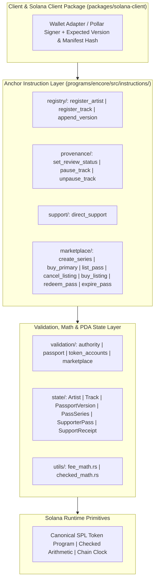
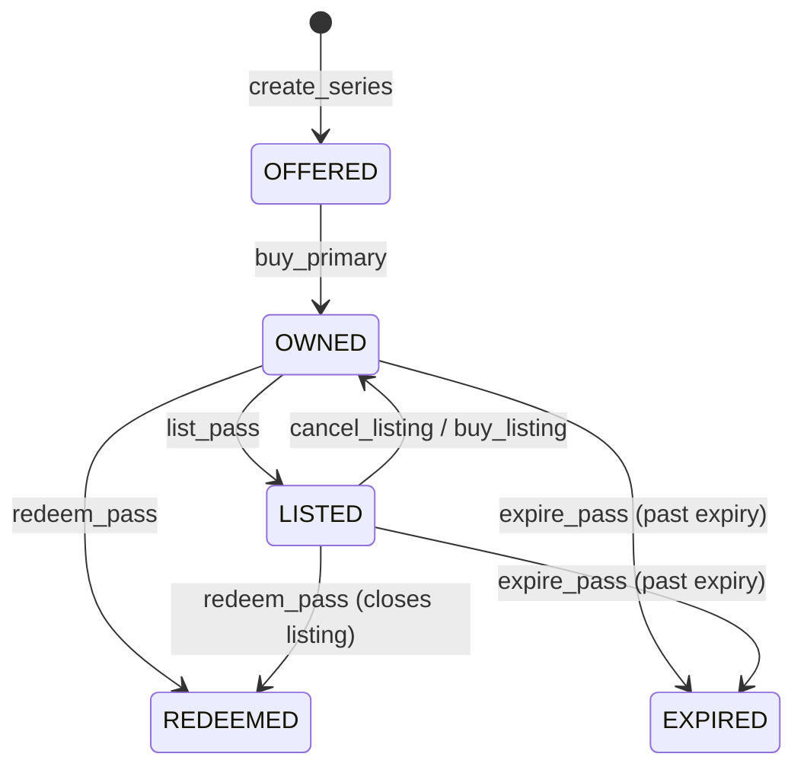

# Solana Anchor Program Specification (`programs/encore`)

> **Design Decision:** Keep a **single modular Anchor program** for the MVP rather than splitting registry and marketplace into separate programs with unnecessary cross-program invocations (CPIs). Tested with **Anchor tests** and **LiteSVM**.

---

## 1. On-Chain Program Stack & Rust Module Layout



### Rust Source Organization (`programs/encore/src/`)
```text
programs/encore/src/
├── lib.rs, constants.rs, errors.rs, events.rs
├── state/          # artist.rs, track.rs, passport_version.rs, pass_series.rs, supporter_pass.rs, support_receipt.rs
├── instructions/
│   ├── registry/   # register_artist.rs, register_track.rs, append_version.rs
│   ├── provenance/ # set_review_status.rs, pause_track.rs, unpause_track.rs
│   ├── support/    # direct_support.rs
│   └── marketplace/# create_series.rs, buy_primary.rs, list_pass.rs, cancel_listing.rs, buy_listing.rs, redeem_pass.rs, expire_pass.rs
├── validation/     # authority.rs, passport.rs, token_accounts.rs, marketplace.rs
└── utils/          # fee_math.rs, checked_math.rs
```

---

## 2. Program Accounts & PDA Seeds

All strings/arrays are bounded; hashes use fixed 32-byte arrays (`[u8; 32]`).

| Account | Fields | PDA Seeds |
| :--- | :--- | :--- |
| `Artist` | `artist_authority`, `payout_wallet`, `profile_hash`, `bump` | `["artist", artist_authority]` |
| `Track` | `artist`, `track_id_hash`, `current_version`, `paused`, `bump` | `["track", artist, track_id_hash]` |
| `PassportVersion` | `track`, `version`, `previous_hash`, `manifest_hash`, `origin_enum`, `evidence_enum`, `rights_flags`, `reviewer`, `recorded_at` | `["passport", track, version.to_le_bytes()]` |
| `PassSeries` | `artist`, `track`, `terms_hash`, `benefit_hash`, `mint`, `cap`, `issued`, `primary_price`, `expiry`, `primary_fee_bps`, `resale_artist_bps`, `resale_fee_bps`, `platform_wallet`, `active`, `bump` | `["series", artist, series_id]` |
| `SupporterPass` | `series`, `serial`, `owner`, `status`, `nonce`, `listing_price`, `listing_expiry` | `["pass", series, serial.to_le_bytes()]` |
| `SupportReceipt` | `payer`, `nonce`, `track`, `version`, `amount`, `recipient`, `bump` | `["receipt", payer, nonce.to_le_bytes()]` |

---

## 3. Pass State Machine



---

## 4. Mandatory Program Invariants

- **Single Owner:** Exactly one `owner` per `SupporterPass`.
- **Supply Cap:** `issued <= cap` enforced on `buy_primary`.
- **Terminal Immutability:** No transfers, listings, or redemptions from `REDEEMED` or `EXPIRED`.
- **Listing Integrity:** `buy_listing` must match exact `nonce`, `listing_price`, and unexpired `listing_expiry`.
- **Authority Checks:** Only `SupporterPass.owner` can `list_pass`, `cancel_listing`, or `redeem_pass`.
- **No Stale Disclosure Checkout:** `direct_support`, `buy_primary`, and `buy_listing` require `expected_version` and `expected_manifest_hash` matching `Track.current_version` and reject if `track.paused == true`.
- **Token & Math Safety:** Canonical SPL Token program only; verify ATA `owner` and `mint`; checked arithmetic (`checked_add`, `checked_mul`, `checked_div`); outgoing transfers always equal incoming payment amount.
- **Replay Protection:** One `SupportReceipt` per `(payer, nonce)`; `SupporterPass.nonce` increments on every listing/sale state change.
- **Immutability:** `PassportVersion` history and `previous_hash` chain cannot be overwritten.
