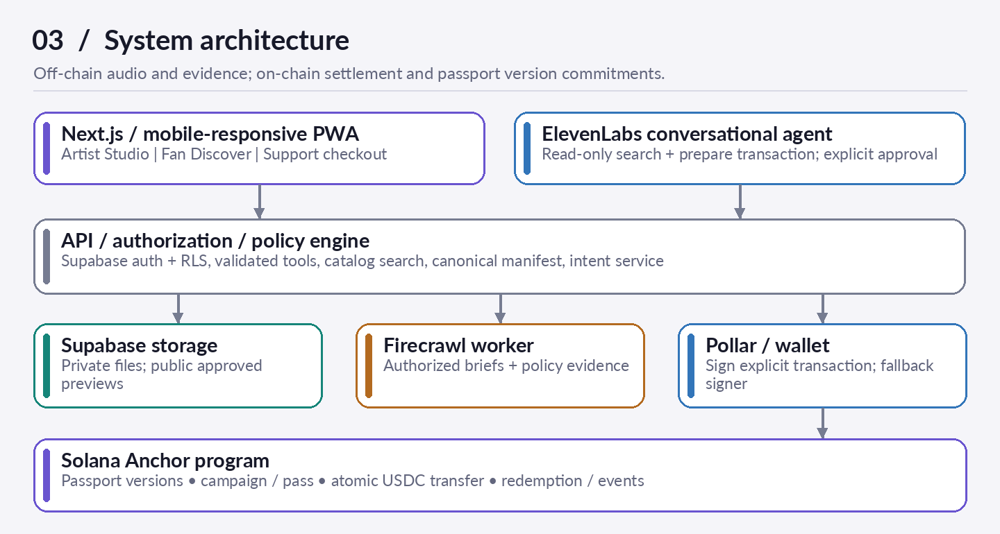
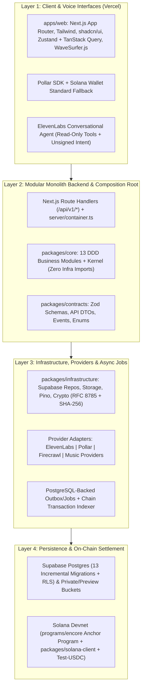

# System Architecture & Modular Monolith Blueprint



> **Locked Architecture Decision:** **TypeScript Monorepo (`pnpm Workspaces + Turborepo`)** containing a **modular monolithic application** (`apps/web` + `packages/core` + `packages/infrastructure`), a **single modular Solana Anchor program** (`programs/encore`), and shared contracts/clients. No microservices, Kubernetes, Redis, or Kafka for the 48-hour MVP.

> **Marketplace Architecture (Target Design):** Encore's marketplace combines two layers on Solana devnet, as illustrated in [`encore-support-marketplace-architecture.html`](../diagrams/architecture/encore-support-marketplace-architecture.html) and [`encore-artist-first-marketplace.html`](../diagrams/architecture/encore-artist-first-marketplace.html):
> 1. **Layer 1 (Base Supporter Commerce):** Three payment paths (`Support` / `Trade` / `Fund`), version-bound `direct_support` (`SupportReceipt`), and finite `PassSeries`/`SupporterPass` primary purchase, fixed-price resale, and redemption.
> 2. **Layer 2 (Project Financing, Spot Trading & Payouts — Devnet/Demo Scope):** Primary campaign escrow (`goal`, `deadline`, `vault`, individual `refund` path), fixed-price `SpotListing` project-share units (with 1-hour candlestick chart from indexed fills / labeled `SYNTHETIC DATA`), distribution-cycle holder claims, and an isolated `1 test USDC`-backed Yes/No opinion market. Legal, rights, issuer, and accounting gates apply before any real-money launch; see [MARKETPLACE_ARCHITECTURE_REVIEW.md](MARKETPLACE_ARCHITECTURE_REVIEW.md).

---

## 1. System Stack & Trust Boundaries



---

## 2. Target Monorepo Structure

*Note: Introduce modules and routes incrementally as features are implemented rather than creating empty boilerplate upfront.*

```text
encore/
├── apps/
│   ├── mobile/                # Universal Expo Router app (Android + Expo Web): Discover, Marketplace, Checkout, Portfolio, Studio
│   └── web/src/               # Next.js API & session boundary (/api/v1/*, same-origin proxy, PKCE handoff)
│       ├── app/api/v1/        # auth, artists, tracks, passports, evidence, rights, discover, support, passes, marketplace, receipts, disputes, agent, opportunities, webhooks, jobs, health
│       └── server/            # container.ts (composition root), request-context.ts, api-handler.ts
├── packages/
│   ├── core/src/
│   │   ├── modules/           # 13 business modules (identity, artists, catalog, provenance, rights, discovery, support, marketplace, settlement, moderation, voice-agent, opportunities, notifications)
│   │   └── kernel/            # entity.ts, domain-event.ts, result.ts, errors.ts, clock.port.ts, unit-of-work.port.ts, queue.port.ts
│   ├── infrastructure/src/    # persistence/supabase/, storage/, authentication/, cryptography/, integrations/{elevenlabs,pollar,firecrawl,music-providers}/, blockchain/{solana,transaction-indexer}/, queue/ (PGMQ), events/, observability/
│   ├── contracts/src/         # api/, schemas/ (Zod), jobs/, auth/, marketplace/, events/, enums/
│   ├── solana-client/src/     # generated/, pda/, instructions/, transactions/, accounts/, events/
│   └── config/                # env/, eslint/, typescript/
├── programs/encore/           # Single modular Anchor/Rust smart contract
├── supabase/                  # migrations/ (identity, PGMQ 0013..0017, marketplace 202611280001+), functions/ (process-jobs), seed.sql, config.toml, tests/
├── tests/                     # integration/, contracts/, queues/, e2e/, security/, fixtures/, benchmarks/
├── scripts/                   # bootstrap.ts, generate-types.ts, seed-demo.ts, reset-demo.ts, create-test-mint.ts, reconcile-payments.ts, verify-deployment.ts
├── docs/                      # Categorized wiki, specs, logs, diagrams
└── .github/workflows/         # ci.yml, contract-tests.yml, security.yml, deploy-preview.yml, deploy-devnet.yml
```

---

## 3. Clean Architecture & Module Import Rules

Every substantial module in `packages/core/src/modules/<name>/` follows a strict layered layout:
- `domain/` — Entities, value objects, policies, domain errors.
- `application/` — Use cases, ports (repository/hash/chain interfaces), DTOs.
- `events/` — Domain events emitted on state transitions.
- `tests/` — Independent unit tests (`Vitest`) with zero DB/RPC dependencies.

### Dependency Direction (Enforced via ESLint & Package Exports)
- **Allowed:** `apps/web` → `@encore/core/*`, `@encore/contracts`, `@encore/solana-client`. `packages/infrastructure` → `@encore/core/*` (implements ports).
- **Forbidden:**
  - `packages/core` importing Supabase, Next.js, ElevenLabs, or Solana SDKs.
  - Deep imports into another module's internal repositories (cross-module calls use public module interfaces or domain events).
  - Client components importing privileged server services (`@/server/container`).

---

## 4. Provider Abstraction & Async Processing (Supabase PGMQ)

- **Provider Isolation (`packages/infrastructure/src/integrations/`):** External providers (`elevenlabs/`, `pollar/`, `firecrawl/`, `music-providers/`) sit behind domain ports (e.g., `OpportunityProvider.extractBrief(url)`). Swapping or falling back never alters core business rules.
- **Supabase Queues (PGMQ) + Cron + Edge Functions:**
  - **Removed from MVP:** Redis, BullMQ, RabbitMQ, Inngest, and separately hosted persistent workers.
  - **6 Queues:** `provenance` (priority), `settlement` (priority), `opportunities` (priority), `licensing`, `notifications`, and `dead_letter`.
  - **Transactional Enqueue:** Application data and PGMQ messages can be committed in the same PostgreSQL transaction, eliminating dual-write drift.
  - **Idempotent Consumption:** `supabase/functions/process-jobs/` consumes bounded batches via `QueuePort` / `PgmqAdapter`, using `job_execution_records` and visibility timeouts so redeliveries never duplicate side effects.
  - **Edge Function Runtime Limits:** `256 MB` memory, `2s` CPU time, `150s` (free) / `400s` (paid) wall-clock duration. Suitable for API calls, metadata validation, and tx reconciliation; heavy FFmpeg/audio inference moves to dedicated workers consuming the same PGMQ queues post-MVP.

---

## 5. Database Architecture & Data Ownership

Incremental migrations (`202611270001_identity.sql`, PGMQ `202611270013..202611270017`, and domain/marketplace `202611280001+`) include RLS policies in the same migration that creates each table.

| Data | Authoritative Source |
| :--- | :--- |
| Artist identity, profiles, listener preferences | Supabase Postgres |
| Audio files, stems, private licensing docs, creation evidence | Supabase Private/Preview Object Storage + Evidence Metadata |
| Music Passport commitments, Pass ownership, Listing state, Settled financial txs | **Solana (`programs/encore`)** |
| Public track metadata & Artist earnings dashboard | Reconciled PostgreSQL read model (checked against chain commitments) |
| Review & appeal history | PostgreSQL + on-chain `PassportVersion` commitments |

---

## 6. Agent Tool Contracts & API Boundaries

- **HTTP API (`/api/v1/*`):** `auth`, `artists`, `tracks`, `passports`, `evidence`, `rights`, `discover`, `support`, `passes`, `marketplace`, `receipts`, `disputes`, `agent`, `opportunities`, `webhooks`, `jobs`, `health`.
- **ElevenLabs Agent Tools (Strictly Allowlisted):** `search_tracks`, `get_passport`, `get_artist_support_options`, `prepare_support_intent` (unsigned), `find_opportunities`, `get_my_release_status`.
- **Forbidden Agent Actions:** `execute_payment`, `grant_license`, `mark_verified`, `read_private_evidence`, arbitrary URL fetch.

---

## 7. Production Scalability Roadmap

1. **Stage 1 — Hackathon (Current):** Modular monolith (Next.js + Supabase + Solana). One web deployment.
2. **Stage 2 — Early Users:** Monolith + dedicated workers (extract transaction indexing, media processing, notifications, and opportunity monitoring).
3. **Stage 3 — Product-Market Fit:** Independently scalable subsystems (search, media delivery, licensed AI inference, high-volume chain indexing) while keeping `packages/core` module boundaries intact.
