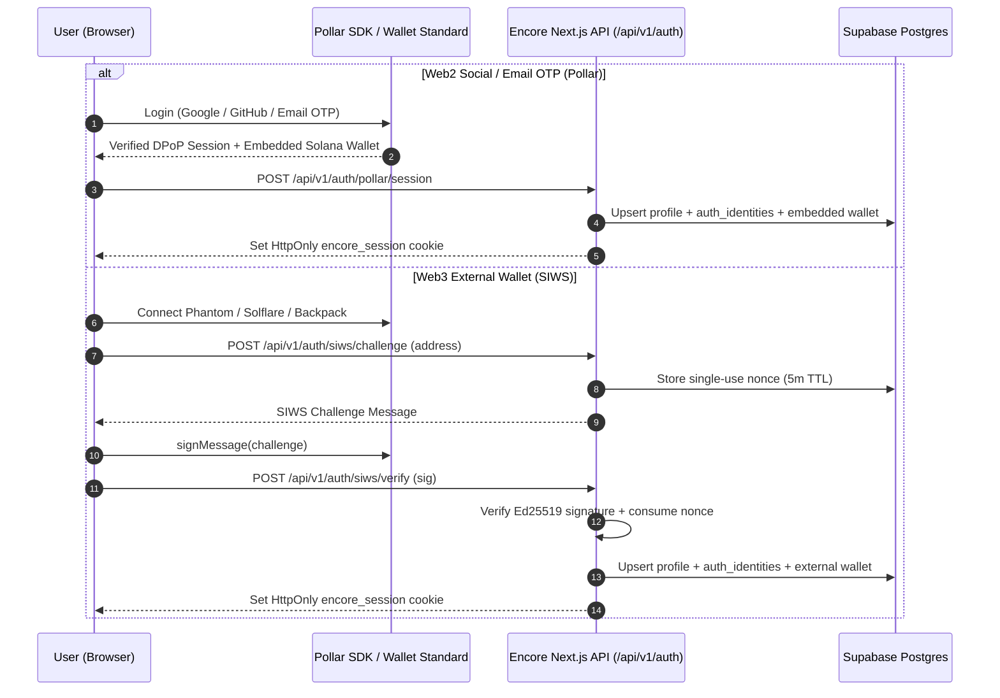

# Authentication & Wallet Onboarding Architecture

## 1. Dual-Path Authentication Sequence

---

## 2. Session Verification & Trust Boundaries

- Pollar tokens are DPoP-bound to a non-extractable browser WebCrypto keypair; Encore's Next.js backend **never** trusts raw client-side Pollar flags as backend authorization.
- After verified Web3 SIWS or Pollar session exchange, Encore issues an **HMAC-SHA256 signed `HttpOnly`, `SameSite=Lax` cookie** (`encore_session`, `2h` TTL).
- All protected routes (`/studio/*`, `/admin/*`, `/api/v1/auth/onboarding`) verify `encore_session` server-side via `requireAuthenticatedUser()`.

---

## 3. Database Schema (`supabase/migrations/202611270001_identity.sql`)

Six RLS-enabled tables: `profiles`, `auth_identities` (`unique(provider, provider_subject)`), `wallets` (`unique(address)` with Solana base58 regex check), `user_roles`, `user_preferences`, and `auth_challenges`.
