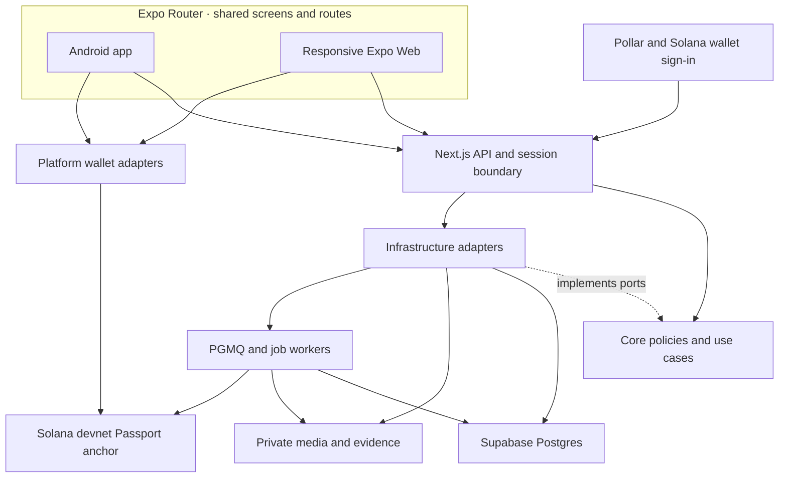
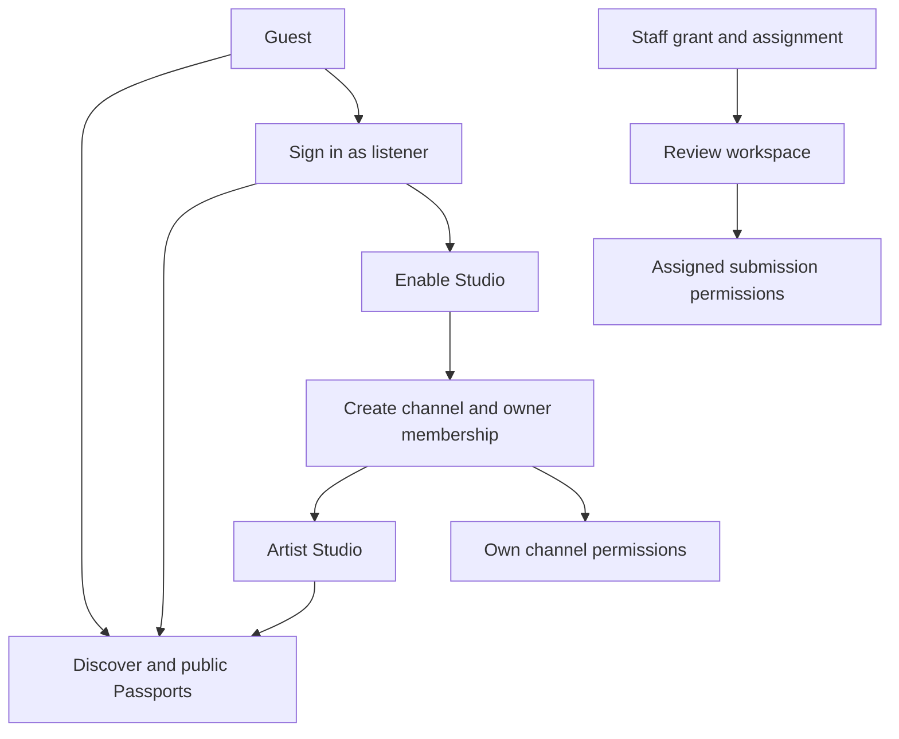
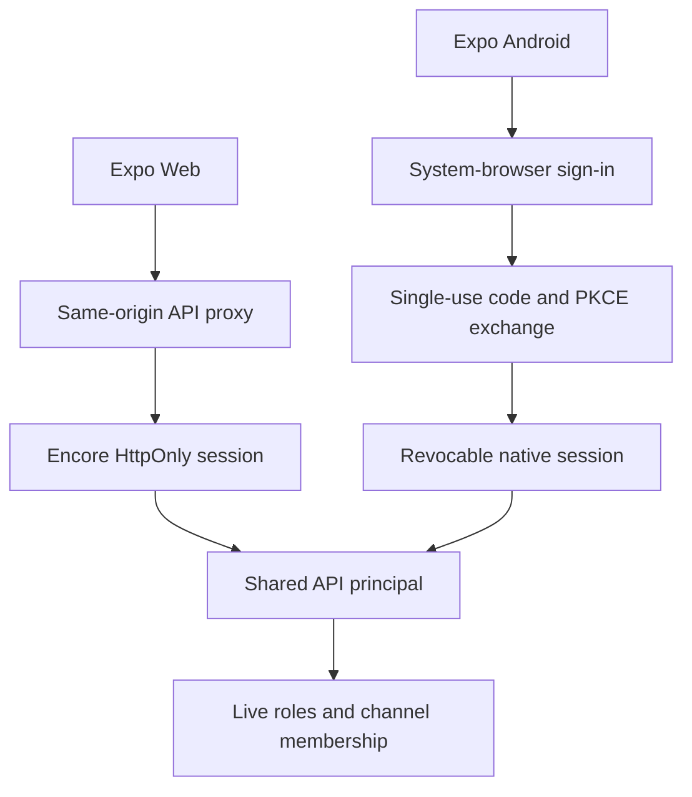
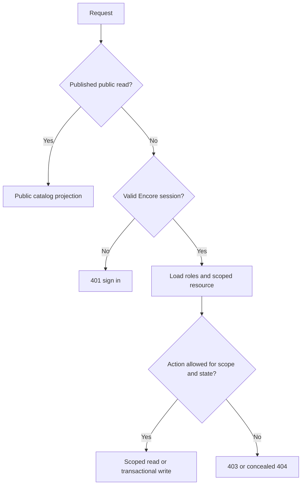
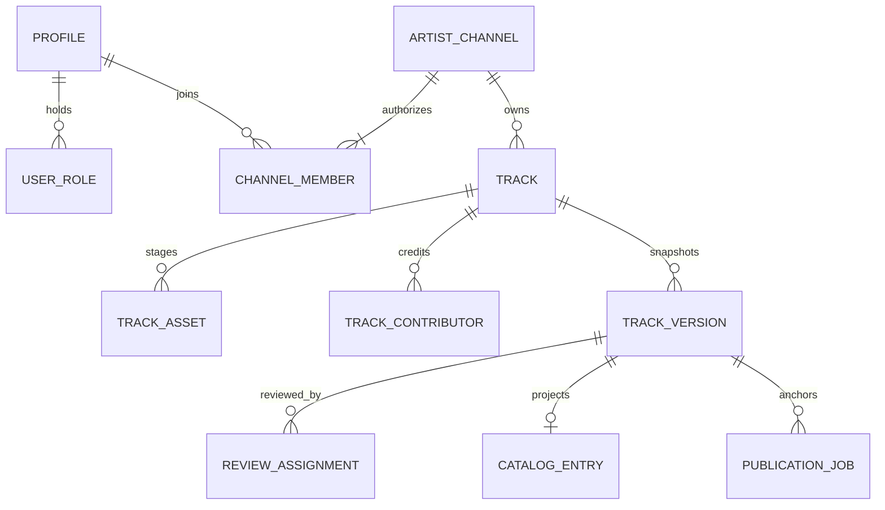
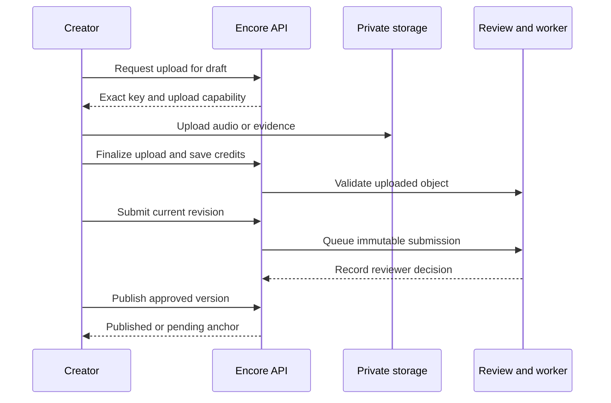
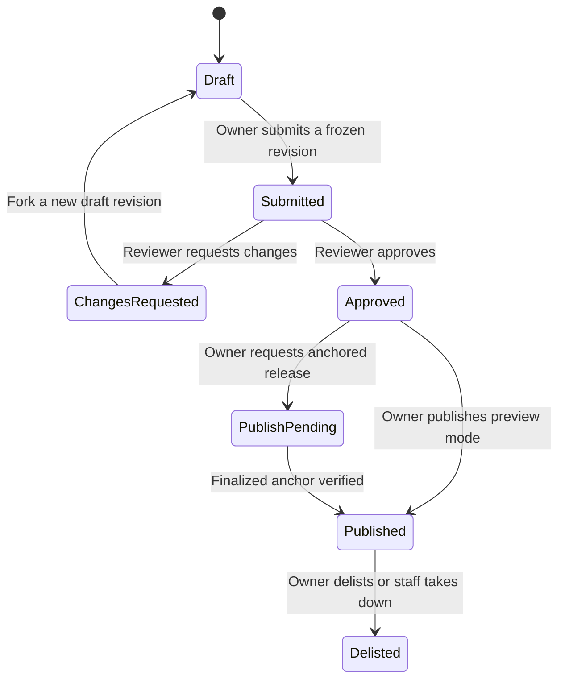
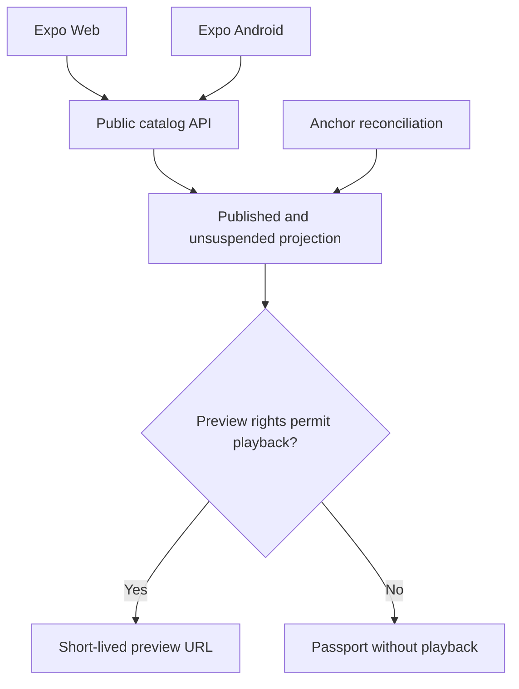

# Encore Artist Studio architecture and integration plan

The first vertical slice is **enable Studio → create a track draft → upload audio → add credits and rights declarations → submit for review → publish to Discover**. An Encore account can listen and own an artist channel at the same time. Studio is a workspace switch, so opening it does not create a second identity or session.

## 1. Stack diagram

| Layer | Responsibilities |
|---|---|
| `apps/mobile` | Universal Expo Router frontend for Discover, Passport, Studio and review. Share routes, forms, contracts and API client. Use responsive desktop navigation and platform adapters for wallet, file picker, playback and local state. |
| `apps/web` | Existing Next.js API and identity service for the MVP. Serve browser API calls through a same-origin `/api/v1` proxy that preserves the browser Origin and cookie flow. Android calls the HTTPS API directly. |
| `packages/contracts` | Shared request schemas, public projections and existing provenance enums. Define distinct creator and public response schemas so private evidence cannot leak through serialization. |
| `packages/core` | Artist channel, track drafts, submission, release, policy evaluation and ports. Depend on contracts and domain types only. |
| `packages/infrastructure` | Scoped Postgres repositories, Storage signing, queue and Solana adapters. Server credentials stay behind the Next.js container or worker. |
| Supabase | Postgres holds identity, membership, workflow and the indexed catalog. Private buckets hold uploaded masters, reviewer evidence and vetted preview derivatives. |
| Solana Anchor | A later integration anchors immutable Passport version hashes and records signed economic actions. The database tracks confirmation and publishes only the confirmed version when anchoring is required. |

## 2. Audience and Creator Studio access

### Session paths

Use the existing signed browser cookie flow for Expo Web. The native session is a proposed integration. The API issues a short-lived, single-use authorization code after verified sign-in and binds the exchange to PKCE and a validated app redirect. Return the code through the app link, store native credentials in secure platform storage, and resolve both session formats to the same Encore user ID. Keep native mutations on bearer authorization and browser cookie mutations on the existing origin checks. Verify the native handoff before enabling authenticated Studio or review actions on Android. A wallet signature alone does not establish an Encore session.

**Enable Studio** is idempotent. Within one database transaction, create the user's first artist channel, add an owner membership and ensure the existing global `artist` grant. Keep the `listener` grant. Existing artist accounts without a channel enter this flow once. Signing in with a connected wallet by itself grants no channel permissions. Wallet proof becomes relevant for recording the payout address or signing on-chain actions.

Use the current `profiles`, `auth_identities`, `wallets` and `user_roles` tables. The existing artist/admin page guard is coarse navigation. Every Studio API and use case checks the requested action against the live channel membership and resource state. The current owner-or-admin helper is too broad for Studio writes.

| Action | Guest | Listener | Channel editor¹ | Channel owner | Reviewer | Admin |
|---|---|---|---|---|---|---|
| Browse published tracks and permitted previews | Yes | Yes | Yes | Yes | Yes | Yes |
| Manage own preferences and prepare fan support | — | Own | Own | Own | Own | Own |
| Enable Studio | — | Self | Self | Self | Self | Self |
| Read channel drafts and edit metadata, credits and audio | — | — | Assigned channel | Own channel | — | — |
| Read/upload private evidence and submit for review | — | — | — | Own channel | Assigned submission read | — |
| Request changes or approve an immutable submission | — | — | — | — | Assigned, outside own channel | — |
| Publish or delist an approved release | — | — | — | Own channel | — | Emergency takedown |
| Change membership or verified payout wallet | — | — | — | Own channel | — | — |
| Manage staff roles, suspend channels and inspect audit records | — | — | — | — | — | Yes |

¹ Model editor membership from day one. Ship owner-only Studio and enable invitations later. Contributor credits describe attribution and splits. They confer no Studio permissions. Staff who also own a channel retain normal owner capabilities there, and have no reviewer authority on their own channel. Initial admin bootstrap is an explicit operational grant. Restrict later staff role changes to authorized admins and audit them.

For browser mutations preserve the existing same-origin JSON protection. Return 404 when a private ID belongs to another channel and 403 when a known member lacks that action. Return 409 for a stale revision or invalid state transition. Recompute grants from the database on mutations so revocations take effect with existing sessions. In Postgres, enable RLS and deny direct client access to private rows and buckets. The server uses a privileged adapter, so RLS does not substitute for authorization. Query by resource and authorized channel together. Recheck membership and transition preconditions inside write transactions, with row locks where needed. Log actor, channel, resource, action, old/new state and correlation ID for privileged changes.

## 3. Data and API contracts

| Proposed data | Key constraints |
|---|---|
| `artist_channels`, `artist_channel_members` | Unique canonical handle and unique channel/user membership. Exactly one owner in MVP. Channel state active or suspended. |
| `tracks` | Channel foreign key, current draft revision and optional published version pointer. Every edit uses optimistic revision checking. |
| `track_assets` | Channel/track scope, opaque storage key, kind, expected size and upload status. Composite references prevent linking uploads across tracks. |
| `track_contributors` | Role, display credit, consent state and optional split in integer basis points. If splits are enabled, require exactly 10,000 bps before settlement is enabled. |
| `track_versions`, `review_assignments` | Frozen submission snapshot, canonical manifest hash and assigned reviewer. Track version number unique per track. Store separate origin, evidence and rights fields. |
| `catalog_entries`, `audit_events` | Public allowlisted projection of the current release. Audit records capture role, review, publication, suspension and payout changes without storing raw credentials or evidence. |
| `publication_jobs` | Unique idempotency key per track version and action. Record pending, confirmed or failed chain anchor and reconciliation metadata. |

| API under `/api/v1` | Integration |
|---|---|
| `GET /auth/me`, `POST /studio/enable` | Current viewer identity and scoped Studio context. Enable Studio server-side, then refresh the session view. |
| `GET /studio/channels/:channelId/tracks`, `POST /studio/channels/:channelId/tracks` | Dashboard and draft creation, scoped by membership. |
| `PATCH /studio/tracks/:id`, `PUT /studio/tracks/:id/contributors` | Replace validated metadata or contributor list using expected revision. Explicit check for permitted fields. |
| `POST /studio/tracks/:id/uploads`, `POST /studio/tracks/:id/uploads/:uploadId/finalize` | Allocate an exact object key and issue upload capability. Finalize the registered upload, not a client-supplied arbitrary object path. |
| `POST /studio/tracks/:id/submit`, `POST /reviews/:versionId/decision` | Snapshot a complete draft and enqueue review work. Reviewer decisions target that immutable version. |
| `POST /studio/tracks/:id/publish`, `POST /studio/tracks/:id/delist` | Owner-triggered release of a specific approved version. Remove public projection and stop issuing preview URLs on delist. |
| `GET /tracks`, `GET /tracks/:slug`, `GET /tracks/:slug/preview` | Web/mobile catalog, public Passport and short-lived preview URL. Require published, unsuspended and preview-authorized rights for playback. |

### Ownership and release data

## 4. Upload and publication flow

- **Upload.** Generate unique keys server-side and disable overwrites. Enforce bucket size/type limits and reserve quota before signing. Use the shortest supported TTL, keep capabilities out of logs and treat them as bearer secrets. A worker checks size, sniffs content and records an object digest before acceptance. Reject unknown or invalid bytes, and reap expired uploads. Give reviewers scoped, short-lived evidence access. Public preview derivatives remain distinct from private masters and evidence. Existing signed playback links can remain usable until expiration.
- **Snapshot.** Submit only finalized assets and validated contributor data. Keep origin, evidence and rights independent. Missing provenance evidence stays `UNKNOWN` or `UNVERIFIED` as applicable. Approval applies to a frozen version. Later edits create a new revision while the published one remains readable.
- **Publish.** Workflow runs draft → submitted → changes requested or approved → publish pending or published → delisted. A rejected version is immutable and its revision can be copied into a fresh draft. Unpublished and delisted releases are absent from public endpoints. Write the projection and workflow state atomically. A takedown affects catalog and playback immediately at the API boundary.
- **Anchor integration.** Canonicalize the approved public manifest, hash it server-side, and keep private evidence and identifiable documents outside the chain payload. Use an idempotent outbox and reconcile the intended program, cluster, signer, version and hash with the finalized transaction before accepting an anchor. In preview mode explicitly show “Not anchored”. In anchor-required mode leave the version pending until confirmed.
- **Sponsor and payments integration.** Pollar handles verified login and wallet UX. ElevenLabs consumes published catalog and Passport read tools only. It cannot execute payments or change verification state. Firecrawl ingests approved public opportunities through a separate queue and never receives private uploads. A payment intent is validated against the published version and verified devnet wallet. The user signs through the wallet UI. Use smallest-unit integers and floor fee splits.

### Release state and Discover integration

## 5. Five-hour Studio slice

Build one set of Expo screens and prioritize the Android vertical slice. Browser parity uses those same screens and API contracts. Verify Expo Web export and native session handoff as explicit gates. If native auth is still pending, demonstrate the authenticated flow in Expo Web and keep Android on public routes until its session exchange is verified.

| Time | Deliverable | Acceptance |
|---|---|---|
| 0:00–0:45 | Channel + owner membership migration, Studio enable and policy helper | Same account opens Discover and Studio. Repeat enable returns the same channel. |
| 0:45–1:45 | Create draft, edit track and save contributor form | Owner can resume after reload. A second artist cannot read or modify the draft. |
| 1:45–3:00 | Private audio upload, finalization and upload status | Real bytes upload from the device, invalid upload cannot be submitted, private object cannot be fetched anonymously. |
| 3:00–4:15 | Owner dashboard and submission snapshot | Dashboard shows draft/submitted status. Edits after submit leave the snapshot intact. |
| 4:15–5:00 | Reviewer and publication smoke test, if available | Reviewer approves a fixture submission. Owner publishes a rights-cleared preview and a listener can find it. If reviewer/publish integration slips, demo through real submission and keep Discover fixtures labeled. |

Follow the five-hour slice with integration in this order: reviewer assignment and audit, published catalog and replacement of fixtures in both Expo targets, devnet Passport anchoring and reconciliation, then wallet-confirmed support and voice discovery. Defer teams, invitations, advanced analytics and multi-channel switching.

## 6. Release checks

| Test | Expected outcome |
|---|---|
| Listener calls Studio write API directly | Denied without an active membership, even if the request supplies an artist role. |
| Artist A swaps draft, upload or version IDs for Artist B's | Private resource reads are concealed and writes have zero side effects. |
| Editor submits directly or changes payout wallet | Denied. Contributor records never grant editor access. |
| Reviewer accesses an unassigned review or their own channel submission | Denied. Decisions include actor, reason and version. |
| Membership or reviewer grant is revoked while signed in | Next privileged request is denied. Previously issued bearer capabilities are bounded by TTL. |
| Concurrent update, duplicate finalize or retry of anchor job | One valid transition. Stale revision returns 409 and retries do not recreate releases or anchors. |
| Rights restricted, channel suspended or release delisted | Public reads and preview issuance enforce the new state. |
| Guest opens published track in web and Expo | Same public projection. No private evidence, internal notes or storage keys. |

## Repo starting points

- `apps/web/src/app/(studio)/studio/dashboard/page.tsx` currently gates access by global artist/admin role and can become the Studio dashboard.
- `packages/core/src/modules/identity/domain/policies.ts` already has global role predicates. Add scoped Studio policies in a dedicated domain module.
- `supabase/migrations/202611270001_identity.sql` has identity and role tables. Extend through new migrations.
- Encore's merged Expo app supplies audience screens and wallet UI. Expo Router is the proposed frontend for both mobile and web. The existing Next.js service supplies the API and identity boundary.
