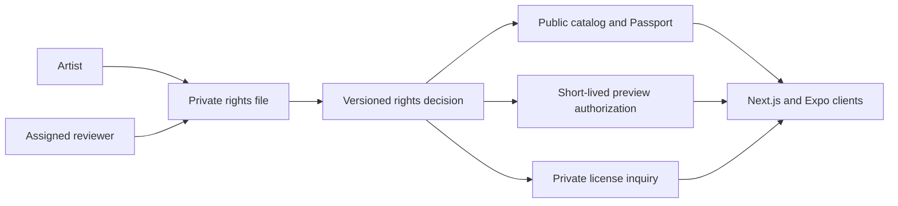

# Phases 5 and 6 implementation plan and handoff

## Inventory

| Capability | Starting point | This implementation |
| --- | --- | --- |
| Rights documentation | Private media, ownership and Passport revisions existed. The preview gate read the uploader's declaration. | A private rights file attaches to an exact Passport version. An assigned independent reviewer or admin records a decision, and approved capabilities expire or can be withdrawn. |
| Provider restrictions | PRD and rights policy specified a conservative approach. | A shared policy independently decides hosted previews, permitted inquiry uses and an official external listing. |
| Licensing | No operational inquiry path. | Buyer submits a scoped inquiry. Owner can decline or accept for discussion. Request and response are private to the participants. |
| Discovery | Next.js search and filters used published releases. Expo used sample records. | Both clients query published, non-delisted records by text, origin, evidence and genre with pagination. |
| Player | Next.js used per-page HTML audio. Expo used a visual placeholder. | Persistent now-playing state per client, a playable-result queue, real preview audio, pause, seek, skip and short-lived source refresh. |

Reviewed inputs include the [Encore stack diagram](../diagrams/architecture/encore-mvp-architecture.html), [phase architecture](../diagrams/architecture/phases/architecture.html), [phase UI flows](../diagrams/architecture/phases/ui-flows.html), [rights workflow](../diagrams/05_rights.png), and the [Spotify engineering account of its web player](https://engineering.atspotify.com/2019/03/building-spotifys-new-web-player). Spotify's [playback state reference](https://developer.spotify.com/documentation/web-playback-sdk/reference) describes client playback position, queue context, and readiness. Encore uses that separation for its own catalog and audio.

## Implementation sequence

1. Add service-only rights records, an audit trail, and reviewer scope checks. Match each release to its current Passport before applying a decision or creating a license inquiry.
2. Project only the approved, unexpired public capabilities into Discover and the Passport. Require a fresh authorization check at the preview endpoint before signing a private media URL.
3. Connect the Next.js and Expo rights workspace, creator forms and buyer inquiry panels to the same API. Retain source documentation and discussion in private records.
4. Connect both players and catalog screens to Encore's APIs. The web player uses a single HTML media element. Expo uses a single SDK audio instance at the route root.
5. Verify role denial, provider policy, expiry, withdrawal, private data isolation, search, browser playback and client builds against disposable data.

## Rights holder review

The artist provides documentation identifying master and composition authority, relevant contributor and source-input permissions, and the exact requested scope. Provider-backed releases also need applicable plan and generation information plus a SHA-256 digest of the applicable terms. Staff see the private text record and its server-generated digest. Authenticity of the underlying agreements is a human review step. A reviewer must be assigned to the artist's channel, and a platform admin can take an independent review. Membership in the artist's channel excludes an assigned reviewer from review. The artist's Encore session establishes the submitting account.

| Provider | Hosted preview | Licensing |
| --- | --- | --- |
| Original | Confirmed worldwide preview permission and affirmative authority and contributor checks | An independently reviewed use can open a private, version-bound inquiry |
| Suno | Reviewed paid entitlement applicable to the output and affirmative hosting and source permissions | No Encore sublicensing |
| ElevenLabs | Reviewed written library authorization in addition to the applicable provider and source documentation | Allowlisted official listing only |
| Other or unknown | Other needs reviewed written hosting permission and the applicable plan and terms. Unknown stays metadata-only. | No Encore sublicensing |

Encore's policy treats paid eligibility for Suno as track-specific. Its published terms have changed across download regimes, so the reviewer checks the applicable snapshot and entitlement date. The ElevenLabs rules distinguish distribution permissions from running a library and prohibit marketplace sublicensing. Sources: [Suno paid rights](https://help.suno.com/en/articles/9601665), [Suno download changes](https://help.suno.com/en/articles/13614785), [ElevenLabs Music Terms](https://elevenlabs.io/music-terms), [ElevenLabs Marketplace](https://elevenlabs.io/docs/overview/capabilities/music/marketplace).

## Client integration and rollout

- Apply `supabase/migrations/202611280013_rights_and_discovery.sql` after the Studio migration. Existing releases without a reviewed file remain searchable as metadata. Review the rights for the exact current version before making a preview available.
- `GET /api/v1/tracks` accepts `q`, `origin`, `genre`, `evidence` and `page`. Track details include reviewed capabilities separately from the anchored Passport snapshot. Public responses omit private object paths, evidence documents, and inquiry records.
- `GET /api/v1/tracks/:id/play?format=json` returns `url` and `expiresAt` after checking the current release and the rights record. Authorizations expire in up to 60 seconds or sooner if the underlying permission ends. Playback resume and retry request fresh authorization when needed. Already issued URLs or buffered bytes can remain usable through their normal lifetime.
- `GET /api/v1/rights` lists the signed-in user's records and inquiries. Assigned staff can request the review queue with `?review=1`. `POST /api/v1/rights` accepts the shared action schema for declaration, review, withdrawal, inquiry and response.
- Inquiries capture use, territory, term and project description. Acceptance opens discussion. A separate agreement is needed before any use. Agreements and payment settlement fall outside this workflow.
- Expo Web exports a single-page app so newly published track URLs can resolve at runtime. Route `/api/v1/*`, `/login`, and Next.js assets under `/_next/*` to the Encore web backend on the same public origin. Serve Expo assets directly and rewrite remaining client routes to its `index.html`. Preserve browser Origin and response cookies. Android and iOS need a rebuilt dev client for the new native audio and secure storage modules.
- Put each authorized MP3, its `metadata.json`, and a private `rights.json` matching `RightsDeclarationSchema` in its existing category folder under `.local/demo-tracks`. The first `pnpm demo:seed` stages the tracks and rights files. An independent reviewer approves each file from the rights workspace. Run the seed again to finalize the existing devnet publication flow. Automated tests use a generated test tone with synthetic permissions and a synthetic publication receipt.

## Local verification

Run `pnpm test`, `pnpm typecheck`, `pnpm lint` and `psql "$LOCAL_DATABASE_URL" -f supabase/tests/rights_and_discovery.sql`. The Playwright scenario is `ENCORE_RUN_RIGHTS_E2E=1 ENCORE_TEST_AUDIO=/path/to/test-tone.mp3 pnpm test:e2e tests/e2e/music`. Use loopback services, a disposable database and private test storage that supports signed URLs and byte ranges.

The local run passed 83 tests, the PostgreSQL checks, the Next.js production build, and both Expo exports. Set `ENCORE_TEST_EXPO_URL` to a locally served Expo export with the same-origin API proxy to include the Expo Web browser check. The cross-client run played the same MP3 in Next.js and Expo Web and confirmed that withdrawal blocks fresh playback authorization. Native-device playback and the hosted rollout remain pending.
