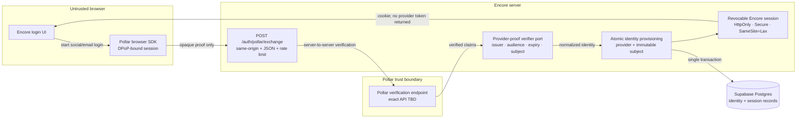

# Draft: Pollar Server Verification Flow

**Status:** Manual review required. Do not implement or enable social/email login yet.

## Required contract

| Boundary | Rule |
|---|---|
| Browser → Encore | Never trust client-supplied email, user ID, roles, wallet, or `authenticated=true`. Accept only a bounded opaque proof. |
| Encore → Pollar | Verify server-to-server using Pollar's documented endpoint/SDK. Validate issuer, audience/app, expiry, subject and proof binding. |
| Identity | Key by `(provider, immutable provider subject)`. Email is profile data, not identity authority. Provision atomically and idempotently. |
| Session | Issue Encore's own revocable session only after verification and persistence succeed. Rotate on login; revoke on logout. |
| Failure | Fail closed: no profile, wallet, role, or cookie on timeout, malformed proof, replay, mismatch, or unavailable verification. |

## Open decision blocking implementation

Confirm from current official Pollar documentation which server-verifiable artifact and endpoint are supported for `@pollar/core@0.12.0`. If none exists, keep social/email disabled and retain SIWS as the only login path.

## Approval gates

1. Confirm the exact Pollar verification API and claim contract.
2. Approve this trust boundary and identity mapping.
3. Add sequence, failure, and test-flow diagrams.
4. Only then implement behind a disabled feature flag.
