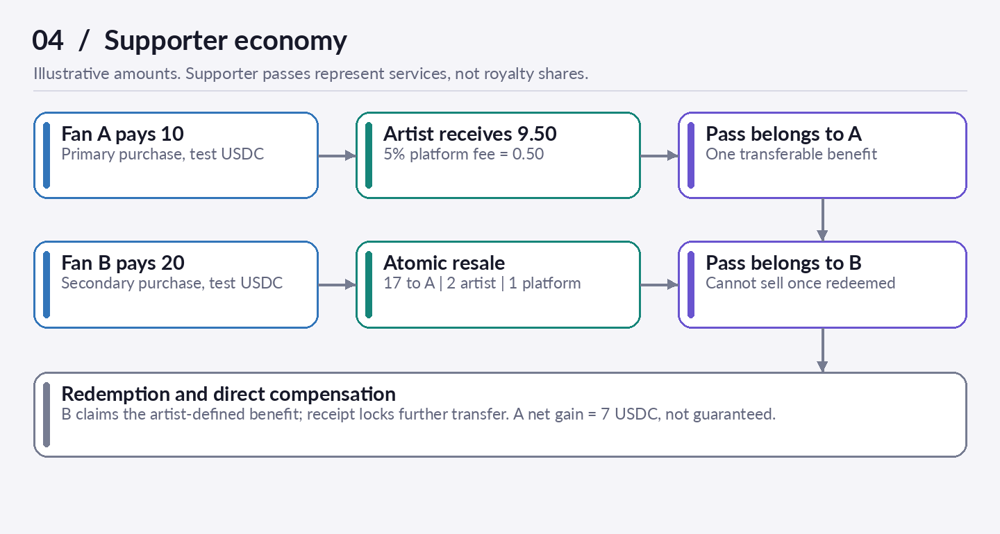
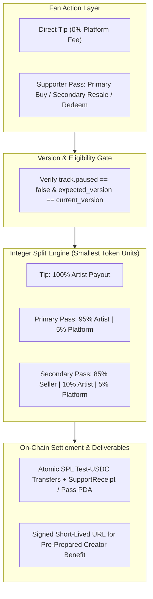

# Tokenomics & Supporter Economy

## 1. Economic Design Principles

- **No Artist Memecoins or Speculative Yield:** Trading alone does not create external economic value. Encore rejects passive profit promises, royalty-share tokens, yield, futures, and AMMs in MVP.
- **Origin-Neutral Payouts:** A creator receives the exact money a fan directs to them (less disclosed fees), regardless of whether the track is `HUMAN_CREATED`, `AI_ASSISTED`, `AI_GENERATED`, or `UNKNOWN`.
- **No Protocol-Manufactured Proceeds:** All inflows equal outgoing transfers to the last smallest token unit (`conservation invariant`).

---

## 2. Economic Settlement Stack & P0 Primitives

### A. Direct Tip
- Fan selects creator, reviews the active `PassportVersion` disclosure snapshot, chooses amount, and signs an atomic test-USDC transfer.
- **Platform Fee:** `0%` in MVP (`100%` goes to `artist.payout_wallet`, network fees disclosed separately).
- **Receipts:** Emits a `SupportReceipt` PDA bound to `(payer, nonce, track, version, amount, recipient)`.

### B. Supporter Pass (`PassSeries` & `Pass` PDA)
- A finite, program-owned transferable entitlement to a **pre-prepared, creator-owned deliverable** (e.g., behind-the-scenes commentary or downloadable non-music creative diary).
- **Delivery:** Hosted privately; signed short-lived URL released upon on-chain `redeem_pass`. Not DRM (previous downloader access cannot be revoked).
- **Non-Investment Status:** Pass metadata defines exact benefit, cap, expiry, transfer rules, and explicit non-copyright / non-investment terms. Proceeds are immediate (not an escrowed all-or-nothing campaign).

---

## 3. Exact Integer Fee Math & Cashflow Examples

All amounts are computed in **integer smallest units** (verified against test-USDC mint decimals). Split terms are pinned on `PassSeries` at creation and apply uniformly across all artist categories.

### Formulas
- **Primary Sale (`amount`):**
  - `platform_fee = floor(amount * 500 / 10000)` (`5%`)
  - `artist_payout = amount - platform_fee` (`95%`)
- **Secondary Resale (`amount`):**
  - `artist_resale_fee = floor(amount * 1000 / 10000)` (`10%`)
  - `platform_fee = floor(amount * 500 / 10000)` (`5%`)
  - `seller_payout = amount - artist_resale_fee - platform_fee` (`85%`)

### Worked Cashflow Examples

| Scenario | Gross Inflow | Seller Receives | Artist Receives | Platform Receives | Net Fan Outcome |
| :--- | :--- | :--- | :--- | :--- | :--- |
| **1. Primary Buy** (Fan A buys Pass) | `10.00 USDC` | — | `9.50 USDC` (95%) | `0.50 USDC` (5%) | Fan A owns unredeemed Pass |
| **2. Resale Gain** (Fan B buys from A) | `20.00 USDC` | `17.00 USDC` (85%) | `2.00 USDC` (10%) | `1.00 USDC` (5%) | Fan A net `+7.00` (before gas/tax); Fan B owns Pass |
| **Combined (1 + 2)** | `30.00 USDC` | `17.00 USDC` | `11.50 USDC` | `1.50 USDC` | Total outflows = `30.00 USDC` |
| **3. Resale Loss** (Fan B buys at 5) | `5.00 USDC` | `4.25 USDC` (85%) | `0.50 USDC` (10%) | `0.25 USDC` (5%) | Fan A net `-5.75`; no guaranteed liquidity |

---

## 4. Transfer & Redemption Guardrails

- Owner can `list_pass` only when `status == OWNED`, eligible, and `Clock < series.expiry`.
- `buy_listing` requires exact `nonce` and `listing_price` (no arbitrary client-supplied payout accounts).
- `redeem_pass` transitions `Pass` to terminal `REDEEMED`, freezes transfers, and closes any active listing.
- If a track is paused due to a credible rights dispute, new primary/resale purchases are blocked while existing benefit redemption remains available unless a specific rights restriction prohibits delivery.

---

## 5. Planning Scenarios (Unvalidated Hypotheses)

- **Bottom-Up Support Scenario:** `100` artists × `50` monthly supporters × `5 USDC` = `25,000 USDC/month` volume. At `5%` fee on passes (if all purchases were fee-bearing), gross fee = `1,250 USDC/month` (direct tips are `0%` fee).
- **Pass + SaaS Hypothesis (Post-P0):** `500` primary passes at `$10` (`$250` fees) + `100` resales at `$15` (`$75` fees) + `30` future `$9` analytics subscriptions (`$270`) = `$595/month` gross hypothetical before API, storage, moderation, and support costs.
