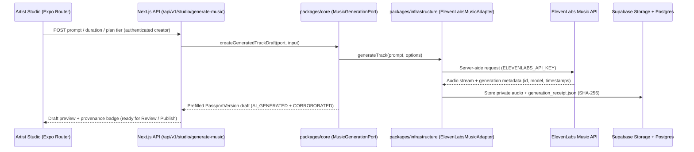

# ElevenLabs Studio Music Generation (`FR05b`)

> **Status:** Planned for **PDF Phase 4 (`H20–30`)** — specification locked in [`plan.md`](../../plan.md) and [`PRD.md`](../PRD.md); server adapter, API route, and Studio UI are **not yet implemented**.

---

## 1. Purpose & Design Boundary

Encore separates **listener voice discovery (`FR05a`)** from **creator-initiated music generation (`FR05b`)**:
- **`FR05a` (Voice Discovery):** Read-only conversational assistant for listeners to search tracks, inspect Music Passports, and prepare unsigned `prepare_support_intent` payloads.
- **`FR05b` (Studio Music Generation):** Allows authenticated artists inside **Artist Studio** to generate original audio drafts via the ElevenLabs Music API, automatically attaching a server-verified **generation receipt** as `CORROBORATED` provenance evidence.

Encore **does not** clone celebrity voices, scrape external catalogs, or issue/resell ElevenLabs Music Marketplace licenses.

---

## 2. End-to-End Architecture & Flow

### Layer Responsibilities (Modular Monolith)
1. **`packages/core`:** Defines the pure `MusicGenerationPort` interface and `createGeneratedTrackDraft` use case. Contains **zero** ElevenLabs, Supabase, or Next.js imports.
2. **`packages/infrastructure`:** Implements `ElevenLabsMusicAdapter` using server-side `ELEVENLABS_API_KEY` and persists both the audio asset and `generation_receipt.json` into private Supabase Storage.
3. **`apps/web`:** Exposes `POST /api/v1/studio/generate-music`, enforcing authenticated creator session + role checks (`requireAuthenticatedUser`), rate limits, and plan-tier rights mapping.
4. **`apps/mobile` (Expo Router):** Provides the **Generate with ElevenLabs** panel in Artist Studio to preview the generated track, inspect its auto-attached `AI_GENERATED` + `CORROBORATED` badge, and submit it to the Music Passport / Review queue.

---

## 3. Provenance & Rights Invariants (`AGENTS.md`)

Encore strictly separates `OriginCategory`, `EvidenceStatus`, and `RightsStatus` for generated tracks:

| Axis | Value for ElevenLabs Studio Draft | Rule / Condition |
| :--- | :--- | :--- |
| **`OriginCategory`** | `AI_GENERATED` *(or `AI_ASSISTED`)* | `AI_GENERATED` for pure ElevenLabs output; `AI_ASSISTED` only when the artist combines the draft with documented human stems/vocals in Studio. |
| **`EvidenceStatus`** | `CORROBORATED` | Attested by the server-captured ElevenLabs generation receipt (request ID, prompt/composition-plan hash, audio SHA-256, timestamp). Manual uploads without a receipt remain `SELF_DECLARED` or `UNVERIFIED`. |
| **`RightsStatus`** | `PREVIEW_ALLOWED` / `COMMERCIAL_CLEARED` / `RESTRICTED` | Mapped strictly from the creator's ElevenLabs plan and Music Terms. Non-commercial tiers cannot be marked `COMMERCIAL_CLEARED`. |

---

## 4. Security & Monetization Rules

- **Server-Only Credentials:** `ELEVENLABS_API_KEY` must never enter `apps/mobile`, Next.js client components, or public responses.
- **No Unattended Settlement or Verification:** Neither the ElevenLabs Music API nor the ElevenLabs conversational agent (`FR05a`) can execute payments, mint passes, or approve `PassportVersion` reviews.
- **Origin-Neutral Monetization:** Once a generated track's `PassportVersion` passes review and is eligible for commerce, it uses the exact same integer payout rules as any other track (`0%` fee on direct tips; `95% / 5%` primary Supporter Pass split; `85% / 10% / 5%` secondary pass resale split).
