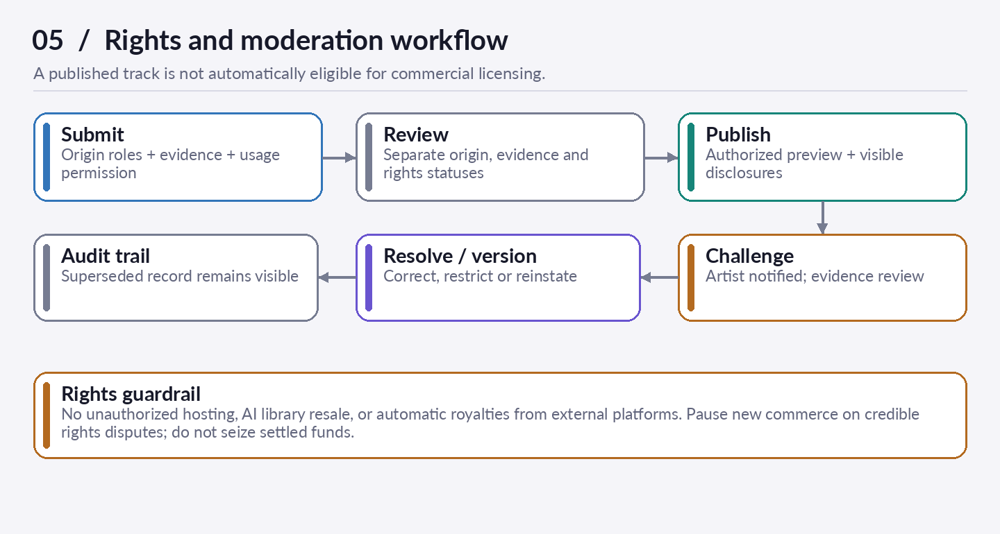

# Artist Rights, Licensing & Documentation Policy

> **Disclaimer:** This document is a product and operational policy, **not legal advice or a license agreement**. Independent legal review is required before live commerce in any jurisdiction (e.g., US, India).

---

## 1. Three-Layer Rights Verification

Encore evaluates three layers independently (`wallet ownership != copyright title`):
1. **Source Copyright & Contract Rights:** Master recording and musical composition permissions, collaborator splits, sample/cover clearances, label/publisher restrictions (see WIPO clearance guide `[21]`).
2. **AI Provider Terms:** Provider plan at time of generation, timestamp, commercial-use scope, and redistribution rules (e.g., Suno paid-plan non-retroactivity `[9]`, ElevenLabs Music Terms `[10]`).
3. **Downstream Customer Permission:** What the listener or commercial buyer is actually allowed to do (`PREVIEW_ALLOWED`, `EXTERNAL_LICENSE_ONLY`, `COMMERCIAL_CLEARED`, `RESTRICTED`).

---

## 2. Creator Documentation Pack (`D01`–`D10`, Private Unless Authorized)

| ID | Document | Contents |
| :--- | :--- | :--- |
| **D01** | Identity & Consent | Artist ID, wallet, authority/representative, contact, eligibility, signed terms version. |
| **D02** | Track Manifest | Title, original/preview SHA-256 hashes, version, origin category, role disclosures, tools/dates. |
| **D03** | Rights Chain | Master & composition owners, split agreements, sample/performer releases, ISRC/ISWC. |
| **D04** | AI Provider Evidence | Provider, plan at generation, timestamp, output ID, commercial scope, dated terms snapshot/hash. |
| **D05** | Distribution Permission | Exact audio preview/hosting/link permission, region, duration, revocation & credit rules. |
| **D06** | Supporter Benefit Terms | Price, supply cap, transferability, expiry, deliverable, refund/remedy, non-investment notice. |
| **D07** | Review & Appeal Log | Evidence hash, reviewer scope, decision, notification, and correction history. |
| **D08** | Payment Receipts | Intent ID, passport version, fee basis, recipient, mint, tx signature, amount, settlement time. |
| **D09** | Optional Commercial Grant | Master + composition authority, territory, media, term, exclusivity, adaptations, attribution. |
| **D10** | Privacy & Takedown | Process to delete private files & remove previews (noting chain hashes/receipts persist). |

---

## 3. Licensing Decision Rules & External Link-Outs

- **`HUMAN_CREATED`:** Requires master/composition authority and preview permission; missing collaborator clearance blocks restricted usage without necessarily blocking permitted metadata.
- **`AI_ASSISTED`:** Requires human rights + source input + provider output terms.
- **`AI_GENERATED`:** Verify provider plan, generation date, and commercial usage scope; never promise copyright exclusivity.
- **`UNKNOWN`:** Metadata may be listed if permitted; no commercial license without affirmative permission.
- **MVP External Marketplaces:** Encore **does not** issue or resell ElevenLabs marketplace licenses. Where an official marketplace listing exists, Encore links out to the provider's checkout (`EXTERNAL_LICENSE_ONLY`); manual receipts are marked self-reported until reviewed and never counted as on-chain payouts.
- **Provider Guardrails:** ElevenLabs Music Terms restrict creating accessible music libraries without express written authorization `[10]`. Suno paid-plan commercial rights are not retroactive by default `[9]`. No third-party track uploads or audio scraping.

---

## 4. Demo Rights Register (Fictional MVP Fixtures)

| Fixture | Category | Required Evidence & Playback Rule |
| :--- | :--- | :--- |
| **H01** | `HUMAN_CREATED` | Original instrumental by team member; signed master/composition/preview consent + raw recording. |
| **A01** | `AI_ASSISTED` | Team-owned arrangement + documented AI-assisted element from permitted workflow; preview only if authorized. |
| **G01** | `AI_GENERATED` | Fully generated track; provider terms/date verified; external listing link or metadata-only if public audio display is restricted. |
