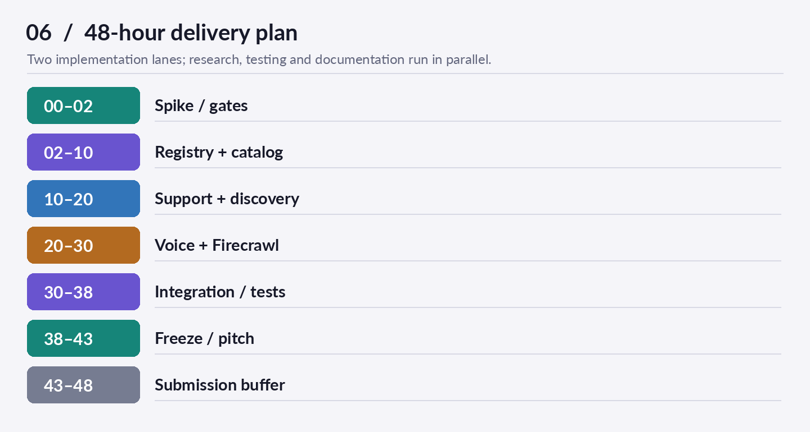

# 48-Hour Hackathon Build Plan & Team Ownership

> **Assumptions:** `H00` = official permitted start. Code freeze at **`H38`**, submission package complete at **`H43`**, **`H43–48`** buffer for blockers & rehearsal only. Team of 4: **Builder A** (Contracts/Economics), **Builder B** (Web/Supabase/APIs), **Research/QA (2 teammates)** (Rights, Fixtures, Testing, Docs, Pitch). Adapt if team size differs.

---

Open the [connected phase roadmap](../diagrams/architecture/phases/index.html) for the finer-grained P00–P15 sequence, phase dependencies, and linked architecture, UI, and testing flows. This document groups the same delivery work into larger batches.

## Phase Schedule & Exit Gates

| Window | Builder A (Contracts & Chain) | Builder B (Web, Data & AI) | Research / QA | Exit Gate |
| :--- | :--- | :--- | :--- | :--- |
| **H00–02** Spike & Scope Lock | Anchor init, airdrop/RPC, test-USDC mint, sample transfer & signer. | ElevenLabs live session + read-only tool, Pollar SDK devnet/custom tx spike, Firecrawl crawl test, Supabase init. | Confirm event rules/sponsor criteria, secure 3 demo audio/metadata permissions (`H01`, `A01`, `G01`), rights template. | Demo funds, working voice, verified test mint, approved track assets, Pollar fallback documented. |
| **H02–10** Registry & First Deploy | `Artist`, `Track`, `PassportVersion`, append & pause; unit tests (auth, hash, monotonicity). | Web scaffold, Supabase Auth/RLS/migrations, artist submission, 3 seeded tracks, manifest view/discovery, staging deploy. | Review evidence & permission records, draft UI copy, test fixtures, issue board, source citations. | On-chain first passport + matching public UI; all 3 categories searchable. |
| **H10–20** Economic Lifecycle | `direct_support`, `PassSeries`/`Pass`, `buy_primary`, `list_pass`/`cancel`, `buy_listing`, `redeem_pass`, conservation tests. | Wallet flow, intent & checkout, finality indexing, artist dashboard, portfolio & redemption delivery. | Run multi-wallet payment scenarios, verify fee sums, draft user terms & test matrix. | Real devnet primary buy → resale → redeem → rejected replay; tip receipt linked to version. |
| **H20–30** Voice, Rights & Leads | Review/appeal version update + stale checkout rejection; finalize program & seed devnet; export IDL. | ElevenLabs tools/session auth, creator dashboard, Firecrawl extraction + opportunity card, official marketplace link-out. | Adversarial voice tests, missing evidence, rights dispute, creator feedback, sponsor integration notes. | Spoken query → catalog result → signed support; real crawl evidence; appeal notice works. |
| **H30–38** Integration & Freeze | >=20 contract tests, concurrency/replay/stale cases, state/event reconciliation; devnet verified. | Accessibility, responsiveness, error/retry states, wrong-network & wallet fallback, Playwright E2E. | 3 full demo runs, validate citations, artist receipts, test reports & consent logs. | All P0 acceptance tests passed/documented; zero critical security defects; **Code Freeze H38**. |
| **H38–43** Docs & Submission | Freeze program ID/IDL, deploy commands, tx links, test output, threat model. | Production-like staging deploy, seed reset, recorded backup video. | `README`, `PRD`, license docs, market-gap slide, sponsor evidence, 3-min script, submission form. | Fresh-device demo & all links verified. |
| **H43–48** Buffer | Fix blockers only. | Retry deploy if needed. | Confirm judge access & rehearse pitch. | **No new features.** |

---

## Cut-Line Rules (If Schedule Slips)
- **Preserve at all costs:** 1 real registered passport per category, ElevenLabs voice search, direct tip + pass buy/resale/redeem, rights/evidence gates, and 1 appeal flow.
- **Cut immediately if P0 tests fail:** Native Solana Mobile app, referral bounties, AI generation, social feed, complex analytics.
- **Fallback for API/Credit Outage:** Retain truthful replay from previously recorded real integration with timestamp; label cached material and disclose failure.
