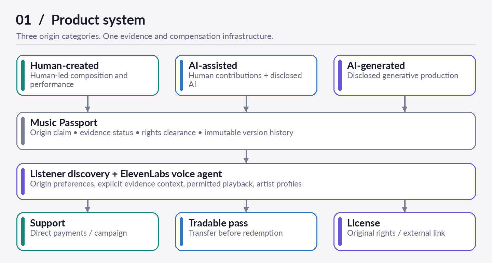
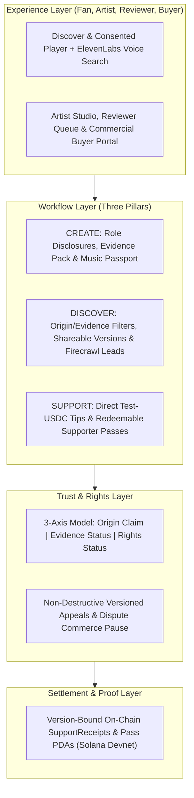

# Product Design & Experience Specification

## 1. Executive Thesis

Encore connects **informed discovery** with **auditable fan support** and **fair creator recourse**:
- Listeners see *how* a track was made (role-by-role), *how strong* the supporting evidence is, and *what rights* apply **before** they tip or buy a pass.
- Creators can contest misclassifications or update disclosures through a **versioned appeal workflow** that preserves historical receipts without silently rewriting past records.
- Origin labels **never** algorithmically reduce a creator's payout or ranking.

---

## 2. Product Capability Stack & Three Pillars

| Pillar | Inspiration | Included in MVP (P0) | Explicitly Excluded |
| :--- | :--- | :--- | :--- |
| **CREATE** | Suno-inspired accessibility | Creator Studio imports original or authorized AI-assisted/AI-generated audio, records role-level contributors/tooling/terms, builds a **Music Passport**, and links out to official generators/licensing providers. | In-app model training, fan remixing, public libraries of provider-generated audio, unauthorized uploads. |
| **DISCOVER** | Spotify-inspired UX | Mobile-responsive player with consented previews, filters by origin category, evidence status, genre, and mood; artist profiles; shareable versioned passport pages; **one ElevenLabs conversational discovery assistant**. | Global streaming catalog, music scraping, celebrity voice cloning, unrestricted recommendation engine. |
| **SUPPORT** | Superfan-inspired economics | Direct test-USDC tips (`0%` platform fee), one bounded series of redeemable transferable **Supporter Passes** (`5%` platform fee, `10%` artist resale fee), atomic resale & redemption. | Artist memecoins, passive profit promises, securities-like royalty financing, yield, futures, AMMs. |

---

## 3. Personas & Jobs-to-be-Done (JTBD)

1. **Artist (Primary):** *"When I publish a track, I want to show how I made it and what rights I possess, correct mistakes, receive transparent income, and reach people who appreciate my work."*
   - Primary target: emerging independent musicians and AI-assisted creators.
2. **Fan (Primary):** *"When I discover a track, I want to know its creation context, make my own preferences, and support the actual credited creator without understanding wallets."*
3. **Commercial Buyer (Secondary):** *"When I need a track, I want to know who can authorize usage and where I can obtain a valid license."*
4. **Reviewer (Operational):** *"When evidence conflicts, I need a reproducible review workflow, not an unexplained label."*

---

## 4. P0 Functional Requirements & Acceptance Criteria

| ID | Feature | Core Requirement | Acceptance Criteria |
| :--- | :--- | :--- | :--- |
| **FR01** | Artist Onboarding | Wallet-linked profile (`display_name`, consent, `artist_id`); submit track with category, role disclosures, permissions, evidence. | Unauthenticated or wrong-owner mutation fails; no upload until privacy/rights attestations accepted. |
| **FR02** | Music Passport | Canonical immutable manifest hash & signer; initial + successor versions; visible category, evidence, rights, roles, date. | Altered manifest fails hash check; superseded version history remains readable. |
| **FR03** | Review & Appeal | Reviewer corroborates, flags inconsistency, or leaves self-declared; artist notified; appeal attaches new private evidence ref. | No silent label rewrite; disputed commerce pauses while track visibility respects rights state. |
| **FR04** | Discover & Playback | Catalog cards show category & evidence separately before checkout; filters (`all`, 3 categories, `unknown`, genre); consented audio or link-out. | Filters return exact fixtures; no unapproved audio bytes served. |
| **FR05** | Voice Discovery | One ElevenLabs agent calls read-only search/manifest tools and prepares an unsigned support intent. | Voice prompt cannot authorize spending or fabricate verified status; user signs separately in UI. |
| **FR06** | Direct Support | Explicit signed test-USDC transfer via program bound to exact recipient and selected `PassportVersion`. | Amount, recipient & mint validated; duplicate intent rejected; chain-confirmed receipt visible to both parties. |
| **FR07** | Supporter Pass | Artist defines finite cap, price, redemption benefit, expiry, fixed resale split; buy, list/cancel, resell, redeem. | Atomic payment/ownership transfer; no duplicate purchase, post-expiry trade, non-owner sale, or double redemption. |
| **FR08** | Artist Dashboard | Release status, evidence requests, dispute reasons, tips/pass revenue, explorer links derived from chain events. | Correct transaction attribution & reconciliation; other users cannot view private docs. |
| **FR09** | Rights Portal | Composition/master permissions & provider terms snapshot; permitted preview, licensing route, limitations. | No local checkout for uncleared rights; external provider links marked external; no fictional external payouts. |
| **FR10** | Firecrawl Leads | Crawl one authorized public brief, extract source URL, date, commissioning need, link to matching artist. | Provenance URL visible; no private data or auto-claimed license sale. |
| **FR11** | Documentation | Exportable JSON/printable receipt, consent, reviewer notes, terms registry, README, architecture, test logs, demo checklist. | Non-coding teammate can reproduce testnet demo using README and fixtures. |

---

## 5. Priorities & Cut-Line Rules

- **P0 (Must Ship):** `FR01`–`FR09`, narrow real Firecrawl call (`FR10`), `FR11`. If time collapses: preserve 1 real registered passport per category, voice search, direct support + pass buy/resale/redeem, rights/evidence gates, and 1 appeal. Manual reviewer over automated classification.
- **P1 (Only after P0 Green):** Notifications polish, expanded catalog, configurable listener allocation, pass campaign goals, public opportunity matching, simple creator analytics, native mobile shell.
- **P2 (Post-Hackathon):** Licensed generation workflows, real streaming distribution, milestone-based all-or-nothing escrow, verified referral payouts, C2PA validation, richer recommendations, legally reviewed commercial licensing.

---

## 6. Visual Identity & Screen Architecture

- **Palette:** Dark charcoal `#151725`, violet `#6954CF`, teal `#168579`, blue `#3275B9`, amber for review/deadline alerts, readable neutral text.
- **Accessibility & Fairness:** Color supplements text labels; **never** use red/green judgmental coding on creative origin. Typography: `Inter` or `Geist`. Mobile-first responsive PWA.
- **Fan Screens:** `Discover` (hero, filters, consented player, persistent voice button) → `Track` (role breakdown, evidence/rights, expandable passport version, Support/Pass) → `Checkout` (exact artist, amount, track/version, fee, benefit, wallet signature) → `Portfolio` (owned passes, list/resell/cancel/redeem, receipts, no unrealized profit hype).
- **Artist Screens:** `Artist Studio` → Profile/Wallet → Track upload/ref → Disclosure checklist → Rights/Evidence upload → Review status → Publish → Create Pass → Earnings (tips vs. primary vs. resale separated; external earnings marked unverified).
- **Reviewer & Buyer Screens:** `Reviewer Queue` (claim, evidence summary, safe private file access, discrepancy checklist, reasoned decision/appeal history) and `Buyer View` (genre/budget/use filter, exact rights, official license link-out).

---

## 7. Three-Minute Pitch & Demo Script (`H38–43`)

| Timestamp | Segment | Action |
| :--- | :--- | :--- |
| `0:00–0:25` | **Problem** | Explain listener confusion & independent artist income gap (cite Deezer/Ipsos & Ditto surveys with caveats). |
| `0:25–0:55` | **Fair Discovery** | Open 3 consented track cards (`H01`, `A01`, `G01`); show role disclosure, evidence, and rights independently without ranking artistic worth. |
| `0:55–1:25` | **Voice Discovery** | Speak to ElevenLabs agent: ask for human-led ambient music, inspect returned passport, select creator. |
| `1:25–1:50` | **Direct Support** | Sign test-USDC tip via wallet; show chain-confirmed receipt & artist dashboard update. |
| `1:50–2:15` | **Supporter Pass** | Buy and resell one Supporter Pass; show fee split, redeem benefit, and reject duplicate redemption. |
| `2:15–2:40` | **Appeal Workflow** | Demonstrate tampered manifest / contradictory evidence flag, artist notification, and versioned appeal. |
| `2:40–2:55` | **Leads & Rights** | Show Firecrawl commissioning brief match & official external licensing link-out. |
| `2:55–3:00` | **Close** | *"Know what you listen to. Choose who you support. Give every legitimate creator a fair path to earn."* |
