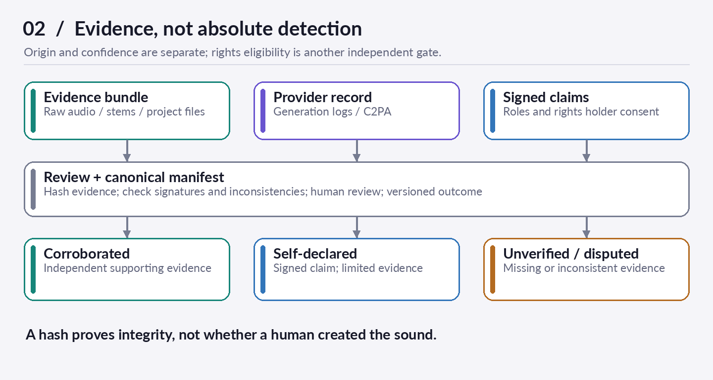

# Creative Origin Taxonomy, Evidence & Fairness Policy

## 1. Separation of Concerns: Claim vs. Evidence vs. Rights

Encore strictly separates three concepts that platforms often conflate:

1. **Creation Category (What happened creatively)** — Track/version-specific, never a permanent judgment on an artist's identity.
2. **Evidence Status (How well the claim is supported)** — Tracks verification confidence without equating missing proof to AI usage.
3. **Rights Status (What is legally/contractually permitted)** — Governs playback, commercial licensing, and pass eligibility independently of origin.

---

## 2. Creation Categories & Role-Level Disclosures

| Category | Definition | Notes |
| :--- | :--- | :--- |
| `HUMAN_CREATED` | Meaningful composition, performance, and recording are human-authored; no disclosed generative AI material included. | Ordinary non-generative digital tools (DAW, EQ, compression) do not change category. |
| `AI_ASSISTED` | Meaningful human creative contribution combined with generative AI in disclosed roles. | Hybrid and transformed works use role-level descriptors; **never** invent a "percentage of humanness." |
| `AI_GENERATED` | Substantive musical expression is generated; human work is principally prompting, selection, or curation. | Prompting/selection/curation roles are credited accurately. |
| `UNKNOWN` | Evidence or disclosure does not establish a category. | Displayed transparently rather than guessed. |

### Role-Level Granularity
Each track manifest records contributors across nine roles:
`lyrics`, `composition`, `arrangement`, `lead/background vocals`, `instrumentation`, `performance`, `recording`, `mixing/mastering`, `production/curation`.

Each role entry carries: `mode` (`human`, `generative_ai`, `assisted`, `unknown`), `creator_ref` or `tool`, `source/version`, `consent`, and `evidence_pointers`.

---

## 3. Evidence Status & Processing Rules

| Status | Meaning | Guardrail |
| :--- | :--- | :--- |
| `SELF_DECLARED` | Signed creator disclosure on record. | Default when creator submits manifest without third-party corroboration. |
| `CORROBORATED` | Reviewer checked independent supporting material; exact scope stated. | **Do not** call corroboration a "proof of humanity." |
| `UNVERIFIED` | Insufficient information to corroborate or classify. | Missing evidence stays `UNVERIFIED`/`UNKNOWN` — never auto-labeled AI. |
| `DISPUTED` | Credible inconsistency or challenge pending. | Pauses new linked pass purchases until resolved. |

### Cryptographic & Evidence Handling
- **Inputs:** Raw recordings/stems, DAW project/change logs, contributor consent, signed creator manifest, AI provider generation record/plan/date, permitted audio fingerprint, optional C2PA Content Credentials, ISRC/ISWC.
- **C2PA Rule:** Import/export compatible assertions only where supported; otherwise mark manifest explicitly as **custom**, not certified C2PA `[20]`.
- **Canonical Hashing:** Compute `SHA-256` over exact original/preview audio bytes and canonical JSON (RFC 8785-style deterministic key ordering). Store salted commitments or digests rather than exposing private filenames.
- **Signatures:** Sign a domain-separated payload (`track_id`, `version`, `prior_hash`, `manifest_hash`, `chain/network`, `nonce`) via wallet-authenticated transaction or verified Ed25519 signature.
- **No P0 AI Detector:** Probabilistic detectors cannot determine ownership or compensation. Hash validation proves post-commitment integrity, not pre-submission truth.

---

## 4. Rights Status Flags

Rights are modeled as separate grants with expiry, **not** an origin score:
- `PREVIEW_ALLOWED` — Authorized audio preview may be streamed on Encore.
- `EXTERNAL_LICENSE_ONLY` — User must be routed to an official external provider/marketplace (e.g., ElevenLabs Music Marketplace).
- `COMMERCIAL_CLEARED` — Cleared for specific scoped commercial use only.
- `RESTRICTED` — Playback or commerce limited by label, sample, or provider terms.
- `DISPUTED` — Active rights challenge; new commerce paused.

---

## 5. Fair Discovery Targets

- **100%** of catalog cards display origin category and evidence status independently before checkout.
- Default discovery presents a mixed catalog with clear filters; no pay-to-rank.
- Spam and duplicates are suppressed uniformly; origin is never inferred from genre or taste.
- **No payment multiplier:** Creators receive the exact fan-directed support (less disclosed fees) regardless of origin category.
- Moderation reasons are always visible to the affected artist.

---

## 6. Appeal & Correction Workflow

1. **Challenge:** Artist or rights holder submits a dispute referencing `track_id`, `version`, reason, and supporting evidence.
2. **Triage:** Reviewer distinguishes origin-only vs. rights risk. On credible rights risk, pause new pass purchases for that track and restrict preview if needed (never freeze unrelated wallet balances).
3. **Notification:** Artist receives reason, requested evidence, deadline, and review contact.
4. **Correction:** Artist submits signed correction; reviewer appends decision and creates a **new `PassportVersion`** linked via `previous_hash`.
5. **Resolution:** Allowed activity resumes if cleared. Original receipts and historical decisions remain immutable; **settled payments are never retroactively reversed** solely because a label changed.
